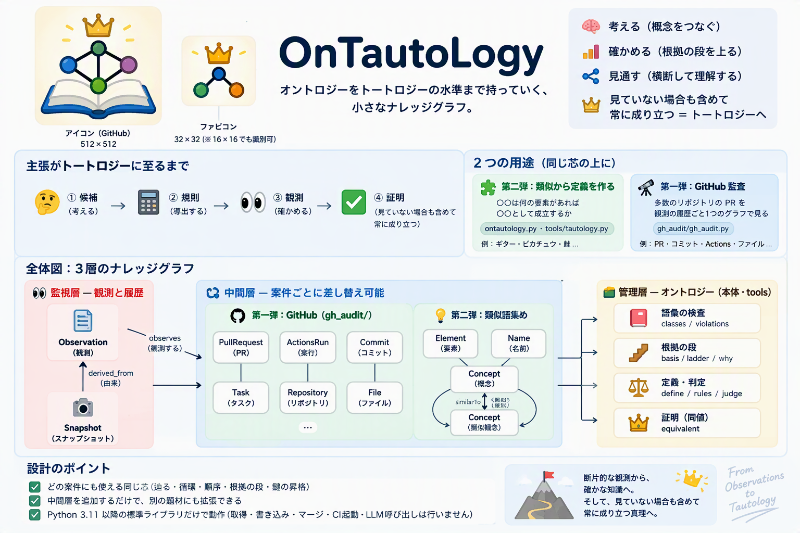
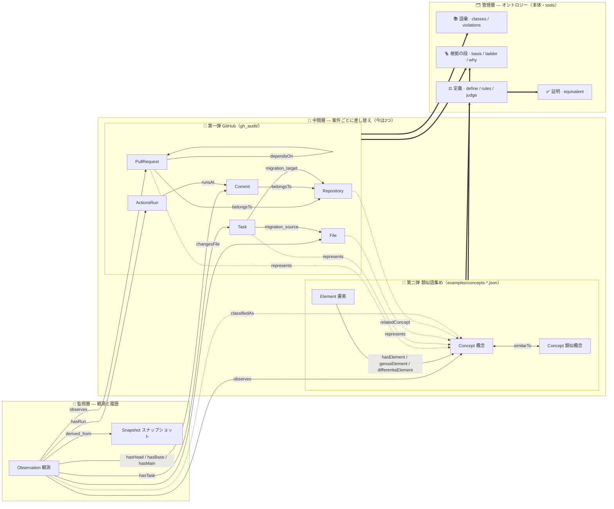
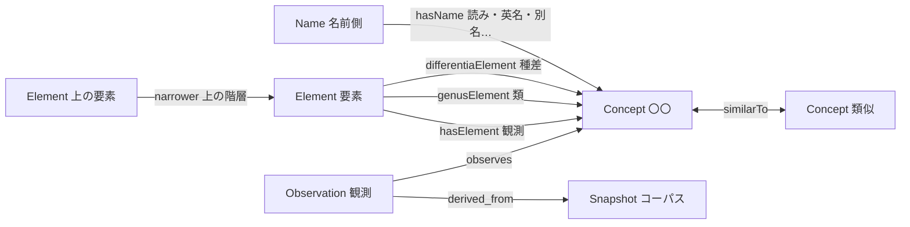
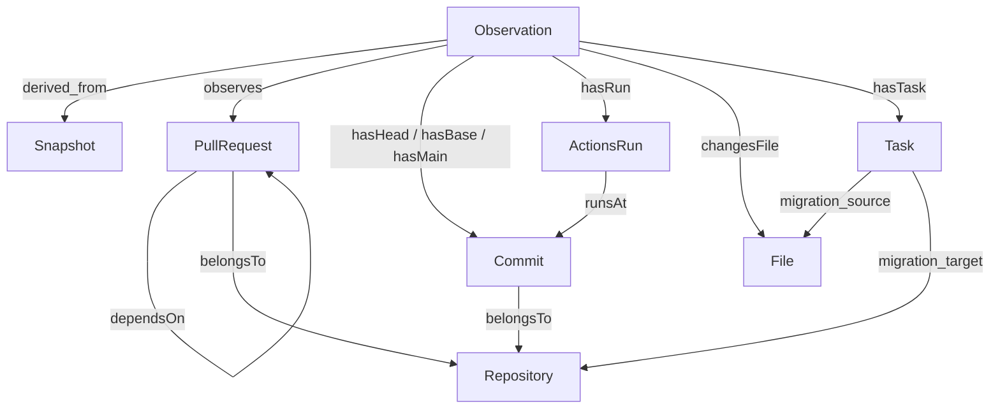
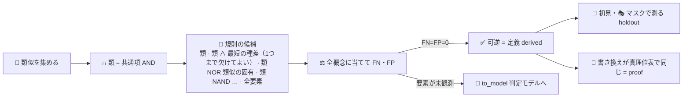

# OnTautoLogy

<p align="center"></p>

オントロジーをトートロジーの水準まで持っていく、小さなナレッジグラフです。主張は 🤔 候補 → 🧮 規則で導出 → 👀 観測 → ✅ 証明 の段を上り、最上段は「見ていない場合も含めて常に成り立つ」＝トートロジーです。Python 3.11 以降の標準ライブラリだけで動き、取得・書き込み・マージ・CI 起動・LLM 呼び出しは行いません。

## 🧭 2つの用途

| | 問い | 置き場 | 例データ |
| --- | --- | --- | --- |
| 🧩 第二弾 | 〇〇は何の要素があれば〇〇として成立するか。「〇〇は🔳🔳の類似」を集め、共通項と見分けから定義を作る | `ontautology.py`（define・roundtrip）＋ `tools/tautology.py`（rules・judge・equivalent） | `examples/concepts-20261115.json` |
| 🔭 第一弾 | 多数のリポジトリの PR を、観測の履歴ごと1つのグラフで見る（親の監査ダッシュボード向け） | `gh_audit/gh_audit.py` | `examples/audit-20261114.json`・`examples/flutter-absorption.json` |

どちらも同じ芯（辿る・循環・順序・根拠の段・鍵の昇格）の上に乗っています。Aoi の命題（逆・裏・対偶と判例）や TalkCompress の往復・判定モデルの延長線です。

## 🧭 全体図（監視・中間・管理の3層）



画像は概観です。クラスと関係の正確な対応は下の Mermaid 図で、テストがコードの語彙と突き合わせています。



| 層 | 役目 | 今あるもの |
| --- | --- | --- |
| 👀 監視層 | いつ・何を見たか（観測と履歴） | Observation・Snapshot（🔭 第一弾と 🧩 第二弾で共通。同じ関係 `observes`・`derived_from` を使い、`digest`・`timestamp` は本体にある） |
| 🔁 中間層 | 案件ごとの実体。ここだけを差し替える | 🔭 第一弾 GitHub（`gh_audit/`）・🧩 第二弾 類似語集め（`concept_edges` と `examples/concepts-*.json`） |
| 🗂️ 管理層 | どの案件にも使うオントロジー | 📚 語彙の検査・🪜 根拠の段・⚖️ 定義・✅ 証明（本体と tools） |

| 線 | 意味 |
| --- | --- |
| ── 実線 | 今のコードにある関係（🔭 は `gh_audit.RELATIONS`、🧩 は `concept_edges`） |
| ══ 太線 | 管理層の関数で扱う（実装済み。🔭 は `validate` が `violations` を使い、🧩 は `define`・`rules` で定義を出す） |
| ┄┄ 点線 | 中間層どうしをつなぐ関係の設計案（`represents`・`relatedConcept`・`classifiedAs`）。まだ実装していない |

- 🔁 **案件を足すときは中間層を1つ足します。** 🔭 第一弾のやり方にならい、案件ごとにフォルダを切って語彙（`RELATIONS`）と読み込み・コマンドを置き、本体の口 `main(commands=..., load=...)` に差し込みます。語彙を引数で受ける `tools/ontology.violations` で検査できるので、管理層（本体と tools）は変えずに済みます。
- 🧪 **図とコードがずれないようにしています。** 実線の関係はコードの語彙にあること、点線の関係はまだ無いこと、中間層の2つの枠にそれぞれの語彙のクラスだけが入っていることをテストで確かめます。点線を実装したら、図も実線に直さないとテストが落ちます。

## 📂 構成

```
ontautology.py          🧠🧩 本体（汎用だけ・標準ライブラリのみ。これ1本を vendor すれば動く）
ontautology_graphs.py   🕸️ 汎用グラフ（畳み込み・独立閉路・単一障害点・最小被覆・近い識別子・first-parent）
onto_path.py            🧭 checkout の根（明示 > 環境変数 > 隣 > マーカーを上へ辿る）
tools/
  tautology.py          🧩⚖️ 第二弾の判定（規則・可逆な定義・真理値表）、証明の段までの距離
  ontology.py           📚 語彙の違反を全部挙げる・鍵に昇格できる属性の組
  knowledgegraph.py     🕸️ 親の fleet コードと同じ名前・形の答え
gh_audit/               🔭 第一弾だけのフォルダ（第一弾の enhancement はここへ）
  gh_audit.py           🔭 第一弾: GitHub 監査（PR 監査・plan・diff・Turtle・Flutter 移管台帳）
vendor/                 📦 親から借りるもの（vendor.lock.json で SHA 固定）: py_launch.cjs・fleet_check.py
examples/               🌱 第二弾の類似コーパス、第一弾の監査スナップショット・移管台帳
tests/                  🧪 unittest（Redis の答え合わせは任意）
docs/                   🖼️ 概念図（repository-concept.png）、📝 方針メモ（policy-rules.md）。♻️ アイコン・ファビコンは CaChereCyCle（OnTautoLogy.icon / .favicon）
```

| 🖼️ アイコン（512×512） | ファビコン（32×32、16×16 でも見分けられる） |
| :---: | :---: |
|  |  |

依存は 🔭 第一弾（gh_audit）→ 🧰 tools → 🧠 本体 の一方向です。🔭 第一弾は `gh_audit/` に閉じていて、本体と tools は gh_audit を読みません（テストで固定）。🧩 第二弾は汎用なので本体と `tools/tautology.py` にあります。

## 🚀 すぐ試す

```sh
# 🧩 第二弾
python -S tools/tautology.py rules examples/concepts-20261115.json             # ⚖️ seeds の〇〇ごとに規則を判定し、可逆な定義を出す
python -S tools/tautology.py judge examples/concepts-20261115.json ギター '["AND", "弦楽器", "撥弦", "フレット"]'   # 🧮 1本の規則の FN・FP
python -S tools/tautology.py classify --rule OR NOT レビュー済み 統合可  # 含意。レビュー済みだけが真なら偽
python -S tools/tautology.py equivalent '["NOR", "a", "b"]' '["AND", ["NOT", "a"], ["NOT", "b"]]'          # ✅ 書き換えが全通りで同じか
python -S tools/tautology.py holdout examples/concepts-20261115.json           # 🙈 初見・🎭 マスクで定義を測る
python -S tools/tautology.py guess examples/concepts-20261115.json --lies 1 --sure 1  # 🎯 当てっこ（食い違いを1回まで許し、確信度1まで確かめる）
python -S tools/tautology.py wobble examples/concepts-20261115.json シャケ るいじ  # 🔤 名前を揺らす（語も引く）
python -S ontautology.py define examples/concepts-20261115.json ギター ピカチュウ 鮭 iPhone エナジードリンク ルイージ   # 🧩 類と種差
python -S ontautology.py roundtrip examples/concepts-20261115.json カフェイン含有 飲料                     # 🔁 要素 → 語の往復

# 🔭 第一弾（gh_audit/）
python -S gh_audit/gh_audit.py audit examples/audit-20261114.json -o graph.json   # スナップショット → グラフ（複数渡すと履歴）
python -S gh_audit/gh_audit.py plan  graph.json                                  # main 未導入の PR の依存順
python -S gh_audit/gh_audit.py transfers examples/flutter-absorption.json        # Flutter の未吸収機能

python -S -m unittest discover -s tests
```

Node からは親の起動役を通します（ツールごとの `.mjs` / `.cjs` は置きません）。

```sh
node vendor/py_launch.cjs -- ontautology.py define examples/concepts-20261115.json ギター
node vendor/py_launch.cjs -- tools/tautology.py rules examples/concepts-20261115.json
node vendor/py_launch.cjs -- gh_audit/gh_audit.py audit examples/audit-20261114.json -o graph.json
node vendor/py_launch.cjs --call equivalent -- tools/tautology.py '["NOR","a","b"]' '["AND",["NOT","a"],["NOT","b"]]'   # 関数を名前で
```

`uv tool install .`（または `uv tool install git+https://github.com/myon-bioinformatics/OnTautoLogy.git`）で入るのは本体の `ontautology` コマンドです。tools と gh_audit はチェックアウトから使います。`ontautology_graphs` は同じインストールで import できます。

## 🕸️ 汎用のグラフ手続き

辺の畳み込み、独立閉路、有向閉路の反例、推移性の反例、単一障害点、最小集合被覆、近い識別子、first-parent の遅れは `ontautology_graphs.py` にあります。分類ごとの集計や語彙表の被覆は呼び出し側に残します。このファイルは標準ライブラリだけで、取得も書き込みもマージもしません。入力は引数か環境変数だけです。

各サブコマンドは `--format text` または `--format json` で出します。`--json` は `--format json` と同じです。JSON もテキストも、ツール名 `ontautology-graphs` と版、入力パス、そのバイト列の sha256 を含みます。同じ入力なら出力は同じです。

```sh
python -S ontautology_graphs.py collapse graph.json directions.json
python -S ontautology_graphs.py basis graph.json --json
python -S ontautology_graphs.py cycle graph.json
python -S ontautology_graphs.py transitive graph.json
python -S ontautology_graphs.py spof graph.json rootA rootB
python -S ontautology_graphs.py cover cover.json
python -S ontautology_graphs.py near graph.json
python -S ontautology_graphs.py lag --repo . --ref main --sha <pinned>
```

- `collapse` は `mutual` または `undirected` の関係について、`a→b` と `b→a` を `a≤b` 側に畳みます。両方向があるときは逆向きを本数にかかわらず落とします（`a→b` が1本、`b→a` が2本なら `a→b` が1本残ります）。`a≤b` 側の多重辺は残します。長さ2の往復を独立閉路に数えないためです。`forward` と `directed`、および向きの指定が無い関係はそのまま残します。自己ループは対ではないので残します。`counts.edges` が入力の本数、`counts.collapsed_edges` が畳んだあとの本数です。
- `basis` は無向多重グラフの基本閉路（独立閉路）です。本数は `E - V + C` で、孤立したノード記録は頂点に数えません。各閉路は元の辺と関係名（ラベル）を持つので、閉路がどの関係を横切るかが分かります。往復を1本にしたいときは、先に `collapse` します。
- `cycle` は有向グラフの単純閉路を1本だけ返します。辺の本数が最少のものを選び、自己ループは1本の閉路なので、それより長い閉路より先に出ます。同じ向きの多重辺だけでは閉路になりません。往復は2本の閉路で、`collapse` する前の `basis` と同じ扱いです。向きは保ったまま回転だけし、逆向きにはしません。同点は `basis` と同じ辺キーと添字の列が辞書順で最小の回転です。探索はその回転を、最短閉路に乗る最小の辺と、始点へ1つ近づく辺のうち最小のものから組み立て、同じ長さの閉路を全部は挙げません。`nodes` はその閉じた歩行で、最初のノードを末尾に繰り返します。`indices` は入力の `edges` の位置です。`A→C`、`B→C`、`B→A`、`C→A` は `A→C→A` になります。無向の `basis` が返す三角形は有向閉路ではありません。閉路が無いときは `cycle: none` です。
- `transitive` は、与えた辺集合の中の道 `a→b→c` で、弦 `a→c` が無いものを1つ返します。`a==c` は有向閉路であって欠けた弦ではないので、自己ループの無い往復は反例にしません。自己ループは要求せず、自己ループ自体も欠けた弦にはなりません。どちらかの一歩が自己ループなら、弦はもう一方の一歩そのもので、それは存在します。`a→c` が1本でもあれば、平行な辺があっても弦はあります。添字はそのリストの位置です。同点は、一歩目の辺キーと添字、次に二歩目の辺キーと添字の順です。関係名では絞らず、調べたい関係の辺だけを渡します。反例が無いときは `witness: none` です。
- `spof` は与えた根からの即時支配点（Cooper–Harvey–Kennedy）と、無向グラフの関節点を返します。各ノードは、それを除くと根から届かなくなるノードの数で順位が付きます。届いていなかったノードは 0 です。根は引数か `OTL_ROOTS`（カンマ区切り）です。
- `cover` は小さい候補集合を厳密に解きます。全体を覆えるときは最小個数で、同点はソートした名前の combinations の先頭です。全体を覆えないときは、覆えた要素が最も多い組です。候補が `--limit`（既定 18。18 個までは厳密、19 個から貪欲）を超えると貪欲法に切り替え、`method` が `greedy` になります。各候補には、それだけが覆う要素も付きます。
- `near` はノード ID と関係名を、casefold、Unicode NFC、末尾の `.git`、先頭と末尾の `/`、camelCase と snake_case（`dependsOn` と `depends_on`）の違いだけでまとめます。報告だけで、統合はしません。`folded` は常に false で、どの正規化が必要だったかを `normalizations` に残します。
- `lag` はローカルな git リポジトリで、ブランチの first-parent 上でピンした SHA より後にあるコミット数と、そのうちのマージ数を数えます。ピンが first-parent の鎖に無いとき（squash で消えたコミットや、側枝のコミット）はエラーです。`git rev-list --first-parent` と `git rev-parse` だけを使い、ネットワークには出ません。パス・参照・SHA は引数か `OTL_GIT_REPO` / `OTL_GIT_REF` / `OTL_GIT_SHA` です。このコマンドの sha256 は、読んだ first-parent 一覧のバイト列です。

Python からは `collapse_reciprocal`、`cycle_basis`、`directed_cycle_witness`、`transitivity_witness`、`single_points_of_failure`、`set_cover_min`、`near_duplicates`、`first_parent_lag` を直接呼べます。

## 経路

checkout の場所は `onto_path.py` が決めます。正本は ONTO の同じファイルで、これはその複製です。関数の本体は同じで、根の名前と環境変数だけがこのリポジトリ用です。解決の順は、明示のオプション、環境変数、隣の checkout、マーカーを上へ辿る、です。

| 根 | 環境変数 | 隣のディレクトリ | マーカー | オプション |
| --- | --- | --- | --- | --- |
| ONTO | `ONTO_ROOT` | `ONTO` | `knowledgegraph.py` | `--onto-root` |
| TaxOntOy | `TAXONTOY_ROOT` | `TaxOntOy` | `otl-relations.json` | `--taxontoy-root` |
| TopOntoLogy | `TOPONTOLOGY_ROOT` | `TopOntoLogy` | `topontology.py` | `--topontology-root` |

import する根は ONTO だけです。TaxOntOy と TopOntoLogy は、そのコマンドが使うときだけ解決します。見つからないときや import に失敗したときは、トレースバックではなく一行で止めます。pytest は依存にせず、`conftest.py` が同じ失敗を `UsageError` にします。検査の正は unittest です。

このリポジトリ自身の環境変数も同じファイルの先頭にまとめてあります。`OTL_ROOTS`、`OTL_GIT_REPO`、`OTL_GIT_REF`、`OTL_GIT_SHA`、`OTL_LIVE`、`OTL_EXPORT_DIR` です。

隣に TaxOntOy と TopOntoLogy があるときは、分類表のパスも CLI のパスも書かずに集計を始められます。`too/` と `tol/` があるときは、そちらを先に使います。

```sh
python -S examples/wave_relations.py
```

## 🗂️ オントロジーを並べて見る

| | 🧩 第二弾（本体・`tools/tautology.py`） | 🔭 第一弾（`gh_audit/`） |
| --- | --- | --- |
| 入力 | `ontautology-concepts/1`（seeds・similar・concepts・names・maybe） | `integration-audit/3`（監査スナップショット） |
| 👀 監視層 | Observation（観測した概念ごと）・Snapshot（コーパスごと） | Observation（PR ごと）・Snapshot（スナップショットごと） |
| 語彙の置き場 | `ontautology.concept_edges` | `gh_audit.RELATIONS`（domain と range） |
| 芯の辺への写し | `concept_edges` | `edges_of` |
| 検証 | `check` | `check` ＋ `tools/ontology.violations` ＋ 監査固有の規則 |
| 手順 | ⚖️ `rules`（〇〇の定義） | 🪜 `plan`（PR の統合順序） |
| 証明の段 | ✅ `equivalent` が埋める | まだ 0 本 |

下の2つの表は、クラスと「そのクラスから出ていく関係 → 先のクラス」をすべて並べたものです。コードの語彙と1つでもずれるとテストが落ちます。

### 🧩 第二弾のクラスと関係

| クラス | 識別子 | 出ていく関係 → 先 |
| --- | --- | --- |
| `Observation` | `observation:` コーパスの digest ＋ Concept の識別子 | `observes` → Concept・`derived_from` → Snapshot |
| `Snapshot` | `snapshot:` コーパスの digest | — |
| `Concept` | `concept:` ＋ 🆔 概念 ID（`id` があれば。無ければ語） | `similarTo` → Concept |
| `Element` | `elem:` ＋ 要素 | `hasElement` / `genusElement` / `differentiaElement` → Concept・`narrower` → Element |
| `Name` | `name:` ＋ 名前側の値 | `hasName` → Concept |



向きは芯と同じで、要素（依存される側）→ 概念（要素が変わったら見直す側）です。監視層は第一弾と同じ形で、コーパス1つが Snapshot（中身の digest なので入力の並び順では変わらない）、要素を見た概念ごとに Observation が1つできます。`hasElement` はその観測を `lock`（主張した記録）として持ち、`captured_at` があれば `observed_at` に入ります。要素が未観測（`null`）の概念には観測がありません。`hasElement` は観察の段（observed）、`genusElement`・`differentiaElement` は `define` の結果（derived、類似先が未観測なら hypothesis）です。`hasName` は名前側（読み・英名・学名・別名・同音語・名前の由来・シリーズ名）で、観察の段ですが定義には入りません。`narrower` は上の階層（`broader` に書いたもの）を上の要素から下の要素へ引いた辺で、コーパスが書いたものなので Snapshot を `lock` に持ちます。

### 🔭 第一弾のクラスと関係

| クラス | 識別子 | 出ていく関係 → 先 |
| --- | --- | --- |
| `Observation` | `observation:` スナップショット digest ＋ PR | `hasRun` → ActionsRun・`targetsBranch` → Branch・`hasBase` / `hasHead` / `hasMain` → Commit・`hasCompletion` → CompletionRecord・`hasEvidence` → Evidence・`missingEvidence` → EvidenceGap・`changesFile` / `updates` → File・`hasPin` → FixedSHA・`hasGeneratedArtifact` → GeneratedArtifact・`hasIssue` → Issue・`missingFromMain` → MainGap・`observes` / `targets` → PullRequest・`hasReview` → Review・`derived_from` → Snapshot・`hasTask` → Task |
| `PullRequest` | `pr:` リポジトリ ＋ PR 番号 | `integrates_into` → Branch・`verified_by` → Evidence・`has_status` → Observation・`blocks` / `dependsOn` / `depends_on` / `duplicates` / `overlapsWith` → PullRequest・`belongsTo` → Repository |
| `Repository` | `repo:` owner/name | `has_status` → Observation・`same_as` → Repository |
| `Snapshot` | `snapshot:` digest | `supersedes` → Snapshot |
| `Commit` | `commit:` リポジトリ ＋ 完全 SHA | `belongsTo` → Repository |
| `Branch` | `branch:` リポジトリ ＋ ブランチ名 | `belongsTo` → Repository |
| `File` | `file:` リポジトリ ＋ 相対パス | `belongsTo` → Repository |
| `ActionsRun` | `run:` リポジトリ ＋ run ID ＋ attempt | `runsAt` → Commit・`hasJob` → Job・`belongsTo` → Repository |
| `Job` | `job:` run ＋ attempt ＋ job ID | — |
| `Task` | `task:` 観測（または台帳）＋ キー | `verifiesCommit` → Commit・`migration_source` → File・`has_status` → Observation・`migration_target` → Repository・`precedes` → Task |
| `CompletionRecord` | `completion:` 観測 ＋ digest | `verifiesCommit` → Commit |
| `FixedSHA` | `fixedsha:` 観測 ＋ digest | `pinsCommit` → Commit |
| `GeneratedArtifact` | `generatedartifact:` 観測 ＋ digest | `generatedFrom` → Commit |
| `Issue` | `issue:` 観測 ＋ digest | `belongsTo` → Repository |
| `Review` | `review:` 観測 ＋ digest | — |
| `Evidence` | `evidence:` 観測 ＋ digest | — |
| `EvidenceGap` | `evidencegap:` 観測 ＋ digest | — |
| `MainGap` | `main-gap:` 観測 | — |



## 🪜 手順を並べて見る（rules と plan）

| 段 | 🧩 第二弾 `rules`（〇〇の定義） | 🔭 第一弾 `plan`（統合順序） |
| --- | --- | --- |
| 1 集める | 類似と要素（`similar`・`concepts`） | PR ごとの観測（スナップショット、複数なら履歴） |
| 2 選ぶ | `seeds` の〇〇とその類似 | PR ごとに最新の観測（同時刻の矛盾はエラー） |
| 3 組む | 類 AND ・ 最短の種差（1つまで欠けてよい）・ NOR / NAND 類似の固有（控え）・ 全要素 | main 未導入の PR と `dependsOn` |
| 4 当てる | 全概念に当てて FN・FP | 芯の `order`（graphlib） |
| 5 止める | FP・FN → `refuted`、未観測 → `to_model` | 循環・その下流・未観測の依存先 → `blocked` |
| 6 答える | 可逆な最初の規則 = 定義（`derived`） | 依存の順（CI・レビュー・競合は別に確認） |
| 7 確かめる | `holdout`: 概念を1つ隠して作り直し、隠した概念で測る（🙈 初見）・要素を1つ隠して測る（🎭 マスク）。`guess`: 何問で当たるか（🎯 当てっこ）。`wobble`: 名前を揺らして、1文字違い・もの側に紛れた名前を見て、わざと揺らした名前が戻るかを数える（🔤）。`cases`: 観測した事例を概念に当て、人の判断と分けて並べる（📋） | ➖ |
| 終了コード 2 | 可逆な定義が無い〇〇がある | ブロック・循環・棚卸しが不確か |

どちらも「見ていないものを完了・成立と読まない」点が同じです。未観測は第二弾では `to_model`、第一弾では `blocked` に残ります。

## 🧰 tools を並べて見る

本体の芯を組み合わせて、名前の意味（オントロジー → トートロジー）に沿った問いに答えます。実装を二重に持たず、芯を呼ぶだけです。

| ファイル | 関数 | 🧩 第二弾で | 🔭 第一弾（`gh_audit/`）で |
| --- | --- | --- | --- |
| ⚖️ `tautology.py` | `holds` `judge` `rules` `holdout` `guess` `guess_report` `wobble` `cases` `equivalent` | 規則での判定・定義・初見とマスクでの評価・当てっこ・名前の表記揺れ・観測した事例と判断・真理値表（CLI あり） | ➖ |
| ✅ `tautology.py` | `standing` `gaps` `entailed` | 定義が立つ段・証明未満の辺 | 監査の辺が立つ段・証明未満の辺 |
| 📚 `ontology.py` | `classes` `violations` `identity` | 鍵に昇格できる属性の組（種差と同じ考え方） | 語彙の検査（`validate` が使う）・クラス一覧 |
| 🕸️ `knowledgegraph.py` | `relation_cycles` `topological_order` | ➖ | 親の `fleet_records` / `vendor_fleet_plan` と同じ名前・形 |

## 📊 例データでの結果を並べて見る

どちらも同じ芯のコマンドで問えます（🧩 第二弾は `python -S tools/tautology.py`、🔭 第一弾は `python -S gh_audit/gh_audit.py` に続けて実行）。

| 問い | 🧩 第二弾 `examples/concepts-20261115.json` | 🔭 第一弾 `examples/audit-20261114.json` |
| --- | --- | --- |
| グラフ | 464 ノード・826 辺（Element 293・Name 84・Concept 43・Observation 43・Snapshot 1） | 720 ノード・2,342 辺（File 542・ActionsRun 93・Commit 32・PullRequest 15・Observation 14 ほか） |
| `check` | 所見なし | 所見なし |
| `reach` | `elem:カフェイン含有` → エナジードリンク（`concept:C004-energy-drink`）・コーヒー・カクテル（カフェインは無いが類似なので見直す） | `file:myon-bioinformatics/Aoi:README.md` → 159 ノード（PR 12） |
| `ladder` | 観測 660・導出 156・候補 10・証明 0 | 観測 2,292・導出 50・候補 25・証明 0 |
| 手順 | `rules`: 11 の〇〇すべてに可逆な定義（終了コード 0）。`holdout`: 初見の誤り 0/462。`guess`: 43 概念すべて平均 3.2 問で当たる（確かめの1問込み）、知らない相手に 98% で「知らない」。`wobble`: 1文字違い 3 組、もの側に紛れた名前 2（サケ属・サケ科。終了コード 2）、わざと揺らすと表記ゆれは 100%・打ち間違いは 94% 戻る。`cases`: 事例 4 件（確定 1・食い違い 1・人が決めた 1・未判断 1。食い違いがあるので終了コード 2） | `plan`: 順序 5・ブロック 1（`SakAnalytics#45` が未観測の `#44` を待つ。終了コード 2） |

🔭 の例は 2026年11月14日 23:12 JST の監査から抜き出した履歴（8 リポジトリ、観測した PR は 14 件）で、今の GitHub の状態ではありません。

## 🧩 第二弾: 類似から定義を作る（本体・`tools/tautology.py`）

追加教材 [ポリゴン2・人間・AI](examples/concepts-20261120.json) では、架空の存在・生物種・機械システムを比較します。3題材と8つの近接概念を比較できます。

```sh
python -I -S ontautology.py define examples/concepts-20261120.json
python -I -S ontautology.py roundtrip examples/concepts-20261120.json 用途:自動応答 入力から出力を推論
```

図鑑名の完全一致と進化関係、人型と人数・展示物・機器の助数詞、AIの手法と実行基盤を個別に検査します。定型応答botとAI搭載botはどちらも自動応答し、上の2条件ではAI搭載botに絞れます。助数詞は教材で指定した場面の属性照合です。


[作品別の図鑑教材](examples/pokedex-editions.json)は、国内本編の『赤・緑』から『LEGENDS Z-A』まで全39版の通常の姿を比較します。
ピカチュウは39版、ポリゴン２は33版に説明があります。残る6版は初登場前と未収録に分け、
`--sources` の `no_entry` に掲載しています。リメイクと対になる作品は別々に数え、
移植・再配信・機種別エディションは同名作品にまとめています。DLCの図鑑は本編に含めます。
作品ごとの記述を手作業で命題IDに対応付け、同じ種の同じ命題を一度ずつ読める文章にします。
条件や頻度まで一致する部分だけに共通IDを使います。各命題を載せた作品と参照URLは `--sources` で確認できます。

```sh
python -I -S tools/tautology.py narrate examples/pokedex-editions.json C003-pikachu
python -I -S tools/tautology.py narrate examples/pokedex-editions.json C012-porygon2 --sources
```

[既存語の命題ケース](examples/detail-propositions.json)では、同じ問いを複数の資料・条件で判定します。
木の実の調理、惑星開発、ベースの調弦、iPhoneの転送仕様、botの応答方式の5題材です。

```sh
python -I -S examples/detail_propositions.py
```

ケースを増やすときは既存の概念を選び、比べる条件を一つ変えます。例えば4弦ベースの弦と調弦を変え、
ギターの低音側4本と「音名が同じか」「実際の音の高さも同じか」をそれぞれ問います。
`observations` は出典ごとの観測です。既存の図鑑では版名、概念コーパスでは概念名を指定します。
外部資料の追加調査ではURLと確認できた真偽だけを記入します。
`questions` には問い・論理式・各観測の期待値を記入します。
判定は成立（`holds`）、否定が成立（`violated`）、未確定（`unknown`）の3通りです。
出力には根拠の属性と出典、欠けた属性、論理式そのものの分類が付きます。
期待値との差があれば終了コード2で該当ケースを返します。

同じ述語で目的語・相手・手段を差し替える場合は `argument_pattern` を使います。
各 `slots` に前置詞（直接目的語は `@none`）、役割、候補値を記入し、先頭の値を基準にします。
上記コマンドの `argument_patterns` は基準と、一度に一つの引数だけを変えた結果です。
対象3候補・手段3候補なら、基準1件と差し替え4件を同じ出典で比較します。
`bindings` には根拠として使える命題だけを登録します。役割の値が `null` の場合も未確定です。
`mapped: false` は命題との対応が未登録、`mapped: true` での `unknown` は、その出典では判定材料が足りないことを示します。

[文法性の比較教材](examples/lexical-gender.json) ではドイツ語・スペイン語・フランス語・ヒンディー語・ポルトガル語の5言語の語例を人間の共通概念に結びます。`python -I -S ontautology.py reach examples/lexical-gender.json lex:fr:personne` で、語から文法性と参照先を確認できます。人物の性別は推論しません。 日英の変換は別のテストで、11概念すべてについて日本語名と英語名の両方向から同じIDと対応語に戻ることを確認します。対象は登録した語義のラベルです。

第二弾の未知語の検証例。登録された語を一つ隠し、後続の引数を順番に観測として与えます。

```sh
python -I -S examples/relation_holdout.py examples/concepts-20261120.json AI搭載bot 用途:自動応答 入力から出力を推論
```

各段階で名前の照合と独立に、用途が一致する候補と、推論機能を共有する一般システムへの応用候補を記録します。この教材用の2規則が返す関係は仮説です。概念の同一性は保留します。

### 📥 集めるもの

```json
{
  "schema": "ontautology-concepts/1",
  "seeds": ["ギター", "ピカチュウ", "鮭", "iPhone", "エナジードリンク", "ルイージ", "スパイダーマン", "AIエージェント", "インシデント", "不安", "エスカレーション"],
  "similar": [{"left": "ギター", "right": "ベース", "basis": "observed"}],
  "maybe": {"ギター": ["金属弦"]},
  "names": {"ギター": ["英名:Guitar"]},
  "broader": {"楽器": ["区分:道具"], "区分:道具": ["上位:もの", "実在:する"]},
  "cases": [{"id": "K001-night-db", "statement": "自分では解けないので…", "actor": "担当A", "role": "一次対応",
             "6W1H": {"誰が": "一次対応", "誰へ": "二次対応", "何を": "DB の応答遅延"}, "elements": ["連絡", "判断を委ねる"]}],
  "judgments": [{"case": "K001-night-db", "concept": "エスカレーション", "holds": true, "actor": "担当D", "role": "障害対応の責任者"}],
  "concepts": {
    "ギター": {"id": "C005-guitar", "elements": ["楽器", "弦楽器", "撥弦", "フレット", "ボディ", "6弦標準", "中高音主体"]},
    "ベース": ["楽器", "弦楽器", "撥弦", "フレット", "ボディ", "4弦標準", "低音主体"]
  }
}
```

- 🌱 `seeds`: 定義したい〇〇。増やすときは `seeds` と `similar`・`concepts` に足すだけです。
- 🔗 `similar`: 「〇〇は🔳🔳の類似」。1つの〇〇に何本でも足せます。`[left, right]` の短い形も可。
- 🤷 `maybe`: 外れているかもしれない紐付け（人がうろ覚えで付けるようなもの）。根拠の段は `hypothesis` で、定義や判定には使わず、当てっこで食い違っても減点しません。例: ベースの `有名なリフ:Seven Nation Army`（実はギターを1オクターブ下げた音）、ミミッキュの `黄色`（黄色いのはピカチュウに似せた布）。
- 🏷️ `names`: 名前側。読み・英名・学名・和名・別名・同音語・名前の由来・シリーズ名など、「何と呼ぶか」を `concepts` と同じ「属性:値」で書きます。名前を聞くのは答えを言うのと同じなので、定義と当てっこの質問には使わず、`wobble`（表記揺れ）だけが使います。
- 🆔 `id`（任意）: 言語によらない概念 ID。番号と、何を指すかが分かる短い英語（`C006-salmon`）です。あればグラフのノードは `concept:C006-salmon` になり、鮭・Salmon・しゃけ といった名前はこの ID にぶら下がります。無ければ今までどおり語が ID です。2つの概念で ID は共有できません。定義・当てっこは ID を見ません。
- 🪜 `broader`（任意）: 上の階層。要素ごとに1つ上の要素を書きます（`楽器` → `区分:道具` → `上位:もの`・`実在:する`）。定義はいちばん近い類のままで、上の階層は当てっこだけが聞きます。グラフでは上から下へ `narrower` の辺になり、`reach` で上の要素から下の概念まで辿れます。上へたどって自分に戻る書き方は入力エラーです。
- 📋 `cases`・`judgments`（任意）: 観測した事例と、それについて人が下した判断です。#19 の「観測と判断を分ける」「人の名前をノードにしない」に沿って、事例には発言（`statement`）・文脈（`context`）・根拠（`evidence`）・人（`actor`）・役割（`role`）・6W1H・見えた要素（`elements`）を別々に持たせます。判断は別の記録（`case`・`concept`・`holds`・`actor`・`role`）で、定義にも候補にも戻しません。
- 🧺 `concepts`: 観察した要素。まだ見ていない概念は `null`（判定モデルへ回る）。値を持つ要素は `開放弦:EADGBE`・`進化の段:1進化ポケモン`・`種族値合計:320`・`商品:レッドブル` のように「属性:値」で書くと、値が違うことがそのまま見分けになります。1つの属性に値をいくつ書いても、当てっこでは1問、定義では1つの手がかりです。

### 🔄 流れ



TalkCompress の判定モデルと同じ分け方で、まず規則が決め、規則で決められないものだけを判定モデル（LLM）に回します。OTL 自身は LLM を呼びません。

### 📊 11の〇〇の定義

`examples/concepts-20261115.json`（43 概念、類似 31 組、seeds 11）で `rules` を実行した結果です。後ろの5つ（スパイダーマン・AI エージェント・インシデント・不安・エスカレーション）は第三弾の試し語（#19）で、要素は3〜5個と少なめです。どの〇〇にも類似を2つ以上入れています。ギターには類似ではないのに類が同じになる紛らわしい相手（ピアノ）もいます。見分ける手がかりは「属性:値」で足しています。

| 〇〇 | 足した手がかり |
| --- | --- |
| 🎸 ギター | 開放弦・代表モデル（ストラトキャスター・レスポール）・有名なリフ |
| ⚡ ピカチュウ | タイプ・分類・進化の段（たね／1進化／2進化ポケモン）・進化方法・初登場世代・種族値（各値と合計） |
| 🐟 鮭 | 産卵・陸封型・料理。🏷️ 名前側に 読み（さけ・しゃけ）・同音語（酒・避け）・別名（アキアジ・トキシラズ）・和名・学名・英名 |
| 📱 iPhone | 音声通話・国内OSシェア（MMD研究所 2026年8月、iPhone 45.6%・Android 54.1%）・見守り（スクリーンタイム／ファミリーリンク）・アクセサリ（MagSafe・Apple Pencil） |
| 🥤 エナジードリンク | 商品（レッドブル・モンスターエナジー・ZONe）。ヌメロンのバイトではなくヒットを狙う、一つ具体的な階層 |
| 🟢 ルイージ | 帽子のマーク・初登場年・誕生（マリオの2Pカラー）。🏷️ 名前側に 主役シリーズ・名前の由来（イタリアで多い名前・日本語の「類似」）・英名 |
| 🕷️ スパイダーマン・🤖 AI エージェント・🚨 インシデント・😟 不安・📣 エスカレーション | 類似2つずつ。出版社・初登場年・作者・拠点・能力の由来（ヒーロー）、手順・外部の道具・出力（ソフトウェア）、起点・急ぎ・例（運用の出来事）、対象・時・行動・エクマンの6感情（感情）、向き・判断の持ち主・契機・例（連絡）。🏷️ 名前側に 英名・読み・別名・略語（Spidey・INC・エスカレ）・韓国語（스파이더맨）・ITIL の用語 |

| 〇〇 | 類似 | 類（共通項） | 定義 = 類 ∧ 手がかり（1つまで欠けてよい） | 「類だけ」の精度（FP） |
| --- | --- | --- | --- | --- |
| 🎸 ギター | ベース・ウクレレ・三味線・バイオリン | 楽器・弦楽器・ボディ | `6弦標準`・代表モデル・有名なリフ の2つ以上 | 0.88（ベース・ウクレレ・三味線・バイオリン・ピアノ） |
| ⚡ ピカチュウ | ライチュウ・ピチュー・デデンネ・プラスル・マイナン・パチリス・ミミッキュ・モルペコ | ポケモン | 種族値 `HP:35` `こうげき:55` `すばやさ:90` `とくぼう:50` `合計:320` の4つ以上 | 0.81（類似の8匹すべて） |
| 🐟 鮭 | サクラマス・スチールヘッド | 魚類・サケ科・サケ属・遡河回遊魚・食用 | `銀白色の体側`・料理 の1つ以上 | 0.95（サクラマス・スチールヘッド） |
| 📱 iPhone | Android・iPad | タッチパネル・アプリ実行環境 | `iOS`・`アクセサリ:MagSafe`・`国内OSシェア:45.6%` の2つ以上 | 0.95（Android・iPad） |
| 🥤 エナジードリンク | コーヒー・カクテル | 飲料 | `タウリン・ビタミンB群`・`炭酸`・商品 の2つ以上 | 0.95（コーヒー・カクテル） |
| 🟢 ルイージ | マリオ・ワリオ・ワルイージ | 任天堂・ゲームキャラクター・人間・帽子・オーバーオール | `初登場年:1983` `帽子のマーク:L` `弟` `緑色` `誕生:マリオの2Pカラー` の4つ以上 | 0.93（マリオ・ワリオ・ワルイージ） |
| 🕷️ スパイダーマン | バットマン・スーパーマン | フィクション・ヒーロー | `クモの能力`・`出版社:マーベル`・`初登場年:1962`・作者 の3つ以上 | 0.95（バットマン・スーパーマン） |
| 🤖 AI エージェント | チャットボット・検索ボット | ソフトウェア | `利用者の代理`・`基盤:言語モデル`・`外部の道具:使う`・`手順:計画して何手も進める`・`出力:作業の結果` の4つ以上 | 0.95（チャットボット・検索ボット） |
| 🚨 インシデント | 原因調査・定型依頼 | 運用の出来事 | `予定外の中断`・`復旧が目的`・`急ぎ:すぐ`・`起点:利用者の申告`・`例:サーバ停止` の4つ以上 | 0.95（原因調査・定型依頼） |
| 😟 不安 | 恐怖・怒り | 感情 | `これからを案じる`・`対象:はっきりしない`・`時:これから`・`行動:備える`・`エクマンの6感情:入らない` の4つ以上 | 0.95（恐怖・怒り） |
| 📣 エスカレーション | 状況報告・担当引き継ぎ | 連絡 | `上位へ引き上げる`・`判断を委ねる`・`向き:上位へ`・`判断の持ち主:上位へ移る`・`例:一次対応から二次対応へ` の4つ以上 | 0.95（状況報告・担当引き継ぎ） |

- 「類だけ」の規則は毎回その類似を通してしまいます（FP）。
- 🔑 **鍵は、いちばん短い種差を「1つまで欠けてよい」でまとめます。** 2つなら OR、5つなら4つそろえば認めます。長い種差は他と共有する要素の組み合わせで、初めて見る相手を通しやすいので使いません。
- 🧺 **1つの属性は1つの手がかりです。** `料理:ちゃんちゃん焼き`・`料理:ルイベ`・`料理:塩焼き` はどれか1つあればよく、3つあっても1つと数えます。当てっこで「料理は？」が1問なのと同じです。
- 🏷️ **定義は もの側だけから作ります。** 名前側（別名・同音語・名前の由来・シリーズ名…）を分ける前は、鮭の定義が別名と同音語に、ルイージの定義がシリーズ名と名前の由来に寄っていました。
- ✋ **「持っているもの」で決める形を先にします。** 類似の固有を NOR で除く形は、見たことのある類似しか除けないので控えです。同じ形どうしなら、短い規則と、類から組んだ規則を先にします。
- 🟢 ルイージの `配管工` は鍵になりません（マリオも持つ）。🎸 ギターは、ピアノが類だけを共有するので鍵が要ります。
- ⚡ ピカチュウはミミッキュ（でんきではない）とデデンネたち（ねずみポケモンではない）が加わって、類が `ポケモン` だけに狭まりました。その分、種族値の値で見分けます。

### 🙈 初見と 🎭 マスク（`holdout`）

集めたものでだけ満点になる定義を見抜くための測り方です。ナレッジグラフ・オントロジーでは、いずれ初めて見るデータや欠けた観測に向き合うので、最初から測ります。

| 測り方 | やること | 数えるもの |
| --- | --- | --- |
| 🙈 初見 | 他の概念を1つ隠して定義を作り直し、隠した概念に当てる | 隠した概念を通してしまった数（FP） |
| 🎭 マスク | 〇〇自身の要素を1つ隠して、元の定義に当てる | 〇〇を認められなくなった数（FN） |

| 段 | 概念 | 🙈 初見の誤り | 🎭 マスクで落ちる | ✂️ 定義の要素数（平均） |
| --- | --- | --- | --- | --- |
| 初回（類似1つずつ） | 12 | 6 / 66（9.1%） | 26 / 40（65%） | 6.5 |
| 類似と紛らわしい相手を増やす | 17 | 6 / 96（6.3%） | 25 / 40（62.5%） | 6.0 |
| ＋見分ける属性・最短の種差だけ | 17 | 4 / 96（4.2%） | 24 / 49（49%） | 6.7 |
| ＋類似を全部2つ以上・鍵は1つまで欠けてよい | 22 | 0 / 126（0%） | 20 / 53（38%） | 6.0 |
| ＋具体的な手がかり（商品・モデル・リフ・料理…）・1つの属性は1つの手がかり | 28 | 0 / 162（0%） | 17 / 77（22%） | 7.5 |
| 名前側を分ける（定義は もの側だけ） | 28 | 0 / 162（0%） | 17 / 67（25%） | 7.3 |
| ＋第三弾の5語（類似2つずつ）・概念 ID | 43 | 0 / 462（0%） | 23 / 87（26%） | 5.8 |
| ＋第三弾の語に見分ける「属性:値」 | 43 | 0 / 462（0%） | 23 / 107（21%） | 6.8 |

- 🙈 **初回の満点は見かけでした。** 6つの〇〇すべてで、いちばん近い類似を隠すと、作り直した定義がそれを通しました。類似を増やすだけでは、ギターは隠したウクレレを、ピカチュウは隠したピチューを通したままでした。
- ⚡ **ピカチュウは、本当に違う属性で直りました。** 進化の段と種族値を入れると、種族値の値が違うので、隠したピチューを弾けます。種族値が1つ欠けても他で認められるので、マスクにも強くなりました。
- 🎸 **ギターは、OR を最短の種差だけにして直りました。** ウクレレを隠すと、`中高音主体 ∧ 撥弦` のような長い種差まで OR でつながり、ウクレレがその枝で通っていました。最短の `6弦標準`・`開放弦:EADGBE` だけにすると弾け、2つあるので片方が欠けても認められます。
- 🎭 **マスクに弱いのは AND です。** 類として AND で並べた要素は、1つ欠けるだけで落ちます。
- 🧩 **残っていた4件は、データと決め方の両方で消えました。** 類似（スチールヘッド・iPad・カクテル・ワリオ・ワルイージ）と属性（産卵・陸封型・音声通話・帽子のマーク・初登場年）を足すだけだと 3/126、決め方だけ変えると 1/96、両方で 0/126 です。
- 🟢 **鍵1つで通すと、隠した双子が入ります。** `配管工` はマリオとルイージだけが持つので、マリオを隠すとルイージの鍵に見えます。「1つまで欠けてよい」なら、配管工しか持たないマリオは弾けます。
- 🥤 **NOR は見た相手しか除けません。** コーヒーを隠すと「カクテルではない飲料」が短くて可逆ですが、コーヒーもカクテルではないので通ります。持っているもので決める形を先にして弾きます。
- 🎭 **マスクで落ちるのは類（AND）の要素だけになりました。** 鍵は1つまで欠けても認めるからです。類が狭まるほど（ピカチュウは `ポケモン` だけ）落ちにくくなります。
- 🧪 **第三弾の5語も初見の誤りは 0 です。** マスクで落ちるのはここでも類の要素だけ（スパイダーマンの `フィクション`・`ヒーロー` など 6 / 40）です。ID・上の階層・事例と判断を足しても、定義は変わりません。

### 🎯 当てっこ（`guess`）

ヌメロンやワードウルフのように、問い合わせの回数で正解に着けるかを測ります。厳しく見分けられるかより、「人が当てっこするときのように、少ない質問で着くか」を見ます。

Portfolio のチャットと CLI は `ontautology.GuessGame` を共有します。チャットと同じ条件は
`python -S tools/tautology.py guess examples/concepts-20261126.json --binary --confirm-name --lies 1` で比較できます。
`--binary` は要素の有無だけを尋ねます。`--confirm-name` は候補名を最後に示し、肯定があったときだけ答えを確定する方式をシミュレートします。

- ❓ **質問は2種類です。** 「その要素がある？」（はい／いいえ）と、`属性:値` の要素に対する「開放弦は？」のような値で返る質問です。値で返る分、ヌメロンのように二択より多くを1問で知れます。
- ✂️ **毎回、残った候補をいちばん均等に割る質問を選びます。** 見込みは二択で理想的に割れたときの回数（log₂ 候補数）です。
- 🧍 **人間らしい失敗を許せます。** `--lies N` で、食い違いを N 回までは候補を残します。`maybe` の紐付けは食い違っても減点しません。
- ✅ **1人に絞れても、まだ答えません。** 絞るのに使った答えは、知らない誰かと共有しているかもしれないので、数えません。その1人だけが持つ答え（全概念の中でいちばん珍しく、まだ聞いていないもの）を聞いて、確信度を積みます。
- ⚖️ **確信度は、推定回数と同じ物差しです。** 1つの答えの重さは log₂(候補数 ÷ 同じ答えの数) ÷ log₂(候補数) で、誰も持っていない答えが1つ合えば 1（1人分を言い当てた重さ）です。合えば足し、合わなければ引きます。それまでに合わなかった答えも、先に引いておきます。
- 🏁 **確信度が `--sure`（既定 1）に届いたら答えます。** 届く前に、許す回数を超えて食い違えば「知らない」です。聞けることが残っておらず、反する答えも無ければ、そのまま答えます（確信度は低いまま返します）。

`examples/concepts-20261115.json`（43 概念、上の階層あり、二択での見込み 6 問）の結果です。

| 許す食い違い | 確信度 | 😊 正直に答える | 🎭 1つ忘れる | 🙈 知らない相手を出す |
| --- | --- | --- | --- | --- |
| 0 回 | 0（確かめない） | 43 / 43 当たる・平均 2.2 問（最大 4） | 354 / 399 当たる（89%） | 30 / 43 で「知らない」と言えた（70%） |
| 0 回 | 1 | 43 / 43 当たる・平均 3.2 問（最大 5） | 305 / 399（76%） | 42 / 43（98%） |
| 0 回 | 2 | 43 / 43 当たる・平均 4.3 問（最大 7） | 256 / 399（64%） | 43 / 43（100%） |
| 1 回 | 0（合わなかった分だけ確かめる） | 43 / 43 当たる・平均 6.4 問（最大 10） | 399 / 399（100%） | 41 / 43（95%） |
| 1 回 | 1 | 43 / 43 当たる・平均 7.4 問（最大 11） | 399 / 399（100%） | 43 / 43（100%） |
| 1 回 | 2 | 43 / 43 当たる・平均 8.6 問（最大 12） | 399 / 399（100%） | 43 / 43（100%） |

- 🎯 **おすすめは2通りです。** 速さなら `--lies 0 --sure 1`（平均 3.2 問、知らない相手に 98%）、取りこぼしたくないなら `--lies 1 --sure 1`（平均 7.4 問、忘れても知らない相手でも 100%）です。確かめの問い数は確信度しだいなので、答えが珍しければ1問、ありふれていれば2問以上になります。
- ⚡ **正直なら見込みより少ない問いで着きます。** 確かめの1問を入れても平均 3.2 問（最大 5）です。値で返る質問と上の階層が効いていて、ピカチュウは「区分は？ → 架空の生き物」「種族値とくぼうは？ → 50」で絞り、「種族値HPは？ → 35」で確かめる3問です。
- 🥤 **具体的な階層はヒットになります。** エナジードリンクは「区分は？ → 飲食物」のあと「商品は？ → レッドブル・モンスターエナジー・ZONe」で1つに決まります。
- ✅ **確かめると、知らない相手を言い当てなくなります。** iPhone を知らないと iPad が残りますが、iPad だけが持つ答えを聞いて「アクセサリは？ → MagSafe」で違うと分かります。鮭を知らないときは、「区分は？ → 生き物」で残る2匹のどちらにも無い「料理は？ → ちゃんちゃん焼き・ルイベ・塩焼き」で、絞る途中で誰も残らなくなります。
- 🎭 **許さないときは、確かめに使った要素を忘れていると正解を言えません**（確信度 0 → 1 で 89% → 76%）。1回許すと、合わなかった分を確信度から引いて確かめ直すので、忘れても当たります。
- 🧪 **語が薄いと、1つ忘れただけで確かめきれません。** 第三弾の語の要素が3〜5個だったときは、1回許しても 24 / 341 を外しました（すべて第三弾の語）。見分ける「属性:値」を足して 399 / 399 です。
- 🪜 **上の階層で、1問で群を割れます。** 11 の〇〇の群は類より上で何も共有しておらず、エナジードリンクは「タイプは？」「初登場年は？」…と他の群を1つずつ外して 12 問かかっていました。`区分`（道具・飲食物・生き物・架空の生き物・架空の人物・仕組み・出来事・心の状態・行い）を足すと、1問目で9つに割れて 3 問です。
- 🪜 **忘れた要素の上の階層は、覚えているものとして答えます。** `楽器` を忘れても `区分:道具` とは答えるので、1つ忘れれば食い違いは1回です。

| 段 | 正直（`--lies 0 --sure 1`） | 正直（`--lies 1 --sure 1`） | 🎭 1つ忘れる（`--lies 1`） |
| --- | --- | --- | --- |
| 28 概念 | 平均 4.4 問 | 平均 8.3 問 | 100% |
| 43 概念（第三弾の語は要素3〜5個） | 平均 6.6 問 | 平均 12.6 問 | 93% |
| ＋見分ける「属性:値」 | 平均 5.4 問 | 平均 10.9 問 | 100% |
| ＋上の階層 | 平均 3.2 問 | 平均 7.4 問 | 100% |
- 🥤 **許さず確信度1のとき、残る1件は隠れた双子です。** エナジードリンクを知らないと、コーヒーを「カフェイン含有」で確かめて通してしまいます。カフェインは隠れたエナジードリンクとだけ共有する特徴なので、知っている範囲ではコーヒーにしか無い手がかりに見えるからです（`holdout` で見た形と同じです）。確信度を2にすれば、もう1問聞いて弾けます。
- 🏷️ **名前は聞きません。** 「英名は？」は答えを言わせるのと同じで、1問で終わってしまうからです。質問は もの側だけです。

### 🔤 名前を揺らす（`wobble`）

表記を少し揺らすと、名前どうしの近さや、もの側に紛れた名前が見えてきます。照合の段は TalkCompress と同じ考え方で、厳密に一致（`exact`）→ 表記ゆれを畳むと一致（`notation`）→ 1文字違い（`near`。1文字の足し・抜け・置き換えと、隣どうしの入れ替え）の順に広げます。どの段の当たりにも、その概念の ID（`id`）が付きます。

- 🧹 **畳む表記ゆれ:** 全角半角（NFKC）・大文字小文字・区切り（空白 `-` `_` `・`）・カタカナとひらがな・長音（`ー` は前の母音に）。`ピカチュー`・`ﾋﾟｶﾁｭｳ`・`ぴかちゅう` は同じです。
- 🔎 **見るもの:** 名前が1文字違いの組（類似かどうかも）、2つの概念が同じ表記を持つ名前（割れる名前）、もの側の要素に紛れた自分の名前や読み（名前の言い換え）です。1文字の語どうしは何でも1文字違いになるので、2文字以上で比べます。
- 🫨 **わざと揺らして戻るか:** すべての名前（概念の語と名前側の値）を、表記ゆれ（カナ⇄かな・長音・全角・大小・区切り）と打ち間違い（1文字抜く・隣どうしを入れ替える）でわざと揺らして引き直します。最初に当たりが出た段を答えとして、元の概念がそこにいれば「戻った」、他の概念もいれば「別の概念に当たった」と数えます。数えるだけで、概念どうしを1つにまとめることはしません。
- 🚦 **終了コード:** もの側に名前が紛れていれば 2 です。

`examples/concepts-20261115.json` の結果です。

| 見たもの | 結果 |
| --- | --- |
| 🔤 1文字違い | ピカチュウ・ピチュー（類似）、ルイージ・ワルイージ（類似）、マリオ・ワリオ（類似に入れていない） |
| 🔁 もの側に紛れた名前（名前側に移す前） | 8: `白鮭(O.keta)`・`主役シリーズ` ×4（マリオ・ルイージ・ワリオ）・`iPadOS`・`代表モデル:ジャズベース` / `プレシジョンベース` |
| 🔁 もの側に紛れた名前（移した後） | 2: 鮭の `サケ属`・`サケ科`（読み `さけ` を名前側に書いたので見つかった） |
| 🔎 語を引く | `シャケ` → 鮭（読み:しゃけ、表記ゆれ）・`酒` → 鮭（同音語:酒）・`salmon` → 鮭（英名）・`るいじ` → ルイージ（1文字違い）・`Spidey` → スパイダーマン（略語）・`스파이더맨` → スパイダーマン（韓国語）。どれも ID 付き（鮭は `C006-salmon`） |
| 🫨 表記ゆれで揺らす | 208 回 → 208 回戻る（100%）。別の概念に当たった 0 |
| 🫨 打ち間違いで揺らす | 1,393 回 → 1,314 回戻る（94%。1文字抜く 96%・入れ替え 92%）。別の概念に当たった 24（ピチュー・ワリオ・ルイージなど名前が1文字違いの相手 20、`スーパーマリ` → スーパーマン 2、`マリ`・`ワリ` → 怒り 2） |

- 🐟 **残る2つは、分類名そのものが鮭にちなんでいます。** 日本語の `サケ属` は鮭の読みを含みますが、学名にすると Oncorhynchus で、鮭の名前に頼りません。訳すと名前の層から離れる例です。
- 🟢 **`るいじ` を引くとルイージに当たります。** 名前の由来（日本語の「類似」）が、表記を揺らすと1文字違いとして出てきます。
- 🍶 **`酒` は鮭に「同音語として」当たります。** `via` がどの名前で当たったかを示すので、同じ語と、同じ音の別の語を取り違えません。
- 🫨 **打ち間違いで戻らないのは、長音の前の1文字です。** `エスカ(レ)ーション` は、抜けた `レ` の母音で `ー` を読んでいたので、畳むと2文字違いになります。`ピカチュウ` から `カ` を抜くと `ピチュウ` で、畳むとピチューと同じなので、最初の答えはピチューです。
- 🈁 **短い語は、群をまたいで1文字違いになります。** `マリオ` から `オ` を抜いた `マリ` は、`怒り` と1文字（`ま` と `怒`）違いです。読みが違っても文字の数で比べるからで、2文字の語の1文字違いは当てになりません。

### 📋 観測と判断（`cases`）

#19 で決めた「発言はまず観測として残し、責任者が判断する」「人と役割を分ける」を、エスカレーションの事例で試します。事例の要素を概念に当てた結果は候補（`hypothesis`）で、人の判断は別の記録（`observed`）です。判断は定義にも候補にも戻しません（一度の判断をルールにしない）。

- 🎯 **候補:** 事例の要素をすべて持つ概念が1つだけで、要素の重さ（当てっこと同じ物差し）が `--sure`（既定 1）に届けば、その概念が候補です。
- 🤖 **`to_model`:** どの概念も持たない要素です。発言から要素を読む（意味解釈）のは中間層の仕事として残します。
- 🕳️ **`missing`:** 6W1H（誰が・誰へ・何を・どうやって・いつまで・どう）の空きです。
- 👤 **人と役割:** `actor` は記録として残すだけで、数えるのは `role` です。

| 事例 | 見えた要素 | 候補 | 人の判断 | 状態 |
| --- | --- | --- | --- | --- |
| K001 夜間の DB | 連絡・上位へ引き上げる・判断を委ねる・契機:自分では解けない | エスカレーション（`C011-escalation`） | 障害対応の責任者: エスカレーション | ✅ 確定 |
| K002 共有だけ | 連絡・状況を伝える・判断は委ねない・向き:関係者へ | 状況報告 | 課長: エスカレーション | ⚠️ 食い違い |
| K003 交代 | 連絡・担当を渡す・契機:交代・引き継ぎメモを書く（`to_model`） | 担当引き継ぎ | — | ⏳ 未判断（いつまで・どう が空き） |
| K004 一報 | 連絡 | —（3つとも当てはまる） | 障害対応の責任者: 状況報告 | 🧑‍⚖️ 人が決めた |

- ⚠️ **食い違いは直さず、見せます。** K002 は「上に伝わったのでエスカレーション」という判断ですが、判断を委ねていないので概念の上では状況報告です。どちらかを書き換えるのではなく、終了コード 2 で人に見てもらいます。
- 🧑‍⚖️ **概念で決められないものは、人の判断がそのまま答えです。** K004 は `連絡` だけなので3つとも当てはまります。

### ⚖️ 判定の読み方

| 判定 | 意味 | 何が覆すか |
| --- | --- | --- |
| 命題（規則 → 〇〇）・対偶 | 規則が通すなら〇〇 | FP（他の概念を通した） |
| 逆（〇〇 → 規則）・裏 | 〇〇なら規則が通す | FN（〇〇を落とした） |
| `reversible` | FN も FP も 0、未観測もなし | 根拠の段は `derived` |
| `to_model` | 要素が未観測で規則では決められない | 判定モデルへ回す |
| `equivalent` | 2本の規則が真理値表の全通りで同じ | 根拠の段は `proof` |

規則は JSON の木で、`["AND", "弦楽器", ["NOR", "4弦標準", "低音主体"]]` のように AND・OR・NOT・NAND・NOR を入れ子にします。空の AND は常に真、空の OR は常に偽です。

### 🔁 往復と類・種差

- `define` は類似群の共通項（類）と、他の全概念から見分ける最小の要素の組（種差）を出します。
- `roundtrip` は要素の集合から元の語へ戻せるかを見ます。`カフェイン含有 飲料` はエナジードリンクとコーヒーの両方に当たり `collides`、`炭酸` を足すとエナジードリンクだけに戻ります（`unique`）。
- 反例（`6弦ベース` など）が来ると `collides` になり、最小識別鍵が組み替わります。類似先が未観測（`null`）や `basis=hypothesis` だけなら `derived` に上がりません。

### ⚠️ 限界と次

- `reversible` は集めた概念の範囲での話です。`holdout` の初見の誤りがその隙間です。
- 初見の誤りが 0 なのは 43 概念の範囲での話です。類似が増えれば、また隠れた双子が出ます。増やすときは、類似を2つ以上と、値で見分けられる「属性:値」を一緒に足します。
- 🔢 鍵の探索は5つで止まります。そのためギターの `開放弦:EADGBE` は、鍵の候補にあっても定義に入っていません（当てっこでは使います）。
- 📅 `国内OSシェア` は 2026年8月の調査の値で、変わります。鮭の輸出入のように年ごとに変わる数字は、出典と時点を付けて足します（まだ入れていません）。
- 🎭 マスクで残るのは類（AND）の要素です。類も「1つまで欠けてよい」にすると、類だけを共有する紛らわしい相手（ピアノ）を通しやすくなるので、測りながら決めます。
- 🎯 当てっこの確かめは、知っている範囲でいちばん珍しい答えを使うので、許さず確信度1のままでは隠れた双子（コーヒーのカフェイン）を見抜けません。確信度2か、1回許すと弾けます。
- 🔤 `wobble` が見つけるのは、もの側に自分の名前や読みがそのまま入っている場合だけです。`iOS` のように名前と綴りが重ならない言い換えや、漢字の読み（`類似` → るいじ）は取れません。読みは名前側に仮名で書いておきます。
- 🧱 「訳しても同じ名前（固有名詞）」かどうかは、まだ測っていません（マリオ → Mario を同じと見るには、ローマ字にする表が要ります）。
- 🤝 マリオ・ワリオは名前が1文字違いですが、類似にはまだ入っていません。入れるかは集める側で決めます。
- 🪜 上の階層（区分・上位・実在）は、群ごとに人が1か所書いたものです。分け方（架空の生き物と架空の人物を分けるか、ソフトウェアを仕組みと呼ぶか）は、当てっこの問い数を見ながら決め直せます。
- 🫨 わざと揺らすのは、名前1つにつき1回だけです。2回以上の打ち間違いや、訳してから戻す往復はまだ測っていません。
- 🆔 概念 ID は seeds の 11 語にだけ付けています。
- 📋 `cases` は事例の要素がそのまま概念の要素と同じ言葉のときだけ当てられます。発言から要素を読み取る（意味解釈）と、6W1H の値が抽象的すぎないかの確認は、中間層（判定モデル）の仕事として `to_model` に残しています。事例と判断はまだグラフに入れていません（人の名前をノードにしない形を #19 で決めてから）。

## 🔭 第一弾: GitHub 監査（`gh_audit/`）

第一弾は `gh_audit/gh_audit.py` に閉じています。GitHub 固有のもの（リポジトリ・PR・コミット・run・job・タスク・移管）はここだけに置き、本体と tools には入れません。第一弾の enhancement はこのフォルダに足します。

入力は継続監査サイトの「統合証跡JSON」（`integration-audit/3`）です。観測 JSON の `{"aoi_integration": {...}}` で包まれた形も受け付けます。GitHub への取得・書き込みは行いません。

### 👀 観測の扱い

- 観測に取得日時・出典・作業状態・merged・mergeable・main 包含を残します。未取得は `null` のままで、false にしません。変更ファイルの未取得は `files_observed=false` で区別します。
- run は自分のコミット（`runsAt`）にだけ結び付けます。PR の head と同じだとは仮定せず、head が未取得の run にはコミットを作りません。attempt ごとに別のノードです。
- 同じリポジトリで変更パスが重なったときだけ `overlapsWith` を導出します（basis は derived）。Git の競合を意味しません。
- 依存は監査側の主張として取り込み、出典と観測 ID を関係に付けます。Turtle では `rdf:Statement` で表し、古い依存を今も有効な事実に昇格させません。
- `edges_of(graph)` が監査グラフを芯の辺に直します。`dependsOn` と `changesFile` は向きを返し、向きのない `overlapsWith` は両向きにします。循環と順序は `cycles GRAPH dependsOn`、`order GRAPH dependsOn` のように依存の辺だけで問います。

### 🪜 統合順序（`plan`）の補足

PR ごとに最新の観測を選び、`contained_in_main=true` の依存先を消化済みとして、芯の `order` で順序を出します。merged だけでは main への導入を推定しません。未観測の依存先、循環、その下流は `blocked` に残し、独立した部分の順序は出します。同時刻に矛盾するスナップショットがあればエラーにします。順序は依存関係の制約だけで、CI・未解決レビュー・競合・保留の受入条件は監査ビューで確認します。

### 📋 open PR の棚卸し（任意）

`open_pr_inventory` は任意のトップレベル配列です。無い入力は従来どおりに計画します。空配列は「どのリポジトリも範囲に含めない」という宣言で、「どこも PR がゼロ」ではありません。各要素は owner/name 1つに対応します。

```json
{"repository":"myon-bioinformatics/Ironmate","checked_at":"2026-11-15T12:00:00Z",
 "complete":true,"open_pr_numbers":[]}
```

- ✅ 完全な要素は、重複のない正の PR 番号（Draft を含む）を並べます。`[]` は、その確認時点でそのリポジトリに open PR が無いことを明示します。取得失敗や部分取得は `"complete":false,"open_pr_numbers":null` で、空配列にはしません。
- 📸 入力ごとに `Snapshot` ノードを作ります（records が無くても）。digest・観測時刻・明示の棚卸しを残し、`derived_from` で PR の観測とつなぎます。Turtle では構造化メタデータを JSON テキストの文字列リテラルにします。
- 🪜 `plan` はリポジトリごとに最新の `checked_at` を使います（不完全でも）。範囲が不完全なら古い PR を予定に入れず `inventory_uncertainty` を返します。完全な範囲がメンバーを決めますが、並んだ PR には同じスナップショットの行が必要で、無ければ `missing_rows` と `blocked` に出ます。古い証跡を今の証跡に昇格しません。同時刻の矛盾は ambiguous として拒否します。
- 🚫 消えたことは完了ではありません。依存先が見えなくなっても、観測で `contained_in_main: true` が確かめられない限り下流をブロックします。履歴のノードと証跡は消しません。不完全な棚卸しでは `plan` の終了コードは 2 です。これは依存の計画であって、マージの許可や CI の判定ではありません。

### 📦 Flutter の未吸収機能

`examples/flutter-absorption.json` に、固定 SHA の元ファイル、移管先候補、受入条件、検証 SHA・Actions 証跡を記録します。初期登録は主要機能 12 群と追加要望 2 件で、全パターンの棚卸し完了や吸収完了は意味しません。アーカイブ後も元 SHA への紐付けを保ち、Flutter の active 監視とは分けます。

- `transfers` は未完了または棚卸し範囲が未確定なら終了コード 2、入力不整合なら 1 です。
- `state=完了` には、元 SHA と移管先 SHA に一致する receipt、移管先ファイル、main 反映の記録、全受入条件の ID、移管先の Actions URL が必要です。これは記録の整合性検査で、CI 結果・main 包含・機能同等性の独立検証ではありません。移管先が未決でも `target.repository=null` で残せます。
- 機能は Task として `migration_source`（元 File）・`migration_target`（移管先 Repository）に結び、5 状態と Snapshot・Evidence を保ちます。追加要望は `kind=request` で既存機能の未吸収と区別します。

監査の入力には「常に成り立つ」と言える関係がないので、証明の段は 0 本です。第二弾の `equivalent` のように、他で証明された関係を辺として渡したときに埋まります。

## 🧠 共通の芯

### 🪜 根拠の段

| basis | 意味 |
| --- | --- |
| `hypothesis` | 誰も確かめていない候補。`reach` は候補として示すだけで、その先へ進まない |
| `derived` | 記録に対する決まった規則（同じ変更パス、名前の一致、集めた概念での可逆な定義など） |
| `observed` | 記録から読んだ。見ていないものについては何も言わない（省略時の既定） |
| `proof` | 見ていない場合も含めて常に成り立つ。ここがトートロジーの段 |

`why` は辿った道で一番弱い段（`weakest`）を返すので、途中に候補が1つあれば証明済みとは読めません。

### 🔗 芯の辺

`{"kind", "source", "target"}` に、呼び出し側が持つもの（`basis`、主張している記録 `lock`、記録自身の時刻 `observed_at` など）を足した dict です。向きは **source = 依存される側 → target = source が変わったら見直す側**。前向きに辿れば影響先、後ろ向きに辿れば根拠です。

| 関数 | 答えること |
| --- | --- |
| `check(edges, nodes=None)` | 形の崩れ、未知の basis、存在しない参照、同じ記録・同じ時刻の主張で中身が違うもの。直さず報告する |
| `reach(edges, start)` | 変更が届く先。深さ・経路・その辺。DAG を仮定しない |
| `why(edges, node)` | 判断が拠っているもの。`cut` は深さ制限で読み残したこと |
| `cycles(edges)` | 循環の代表例。報告するだけで止めない |
| `order(edges, nodes=())` | 「先に必要」の辺から、並行できる組を順に返す（graphlib）。循環とその下流は `blocked`、残りは順序を出す |
| `ladder(edges)` | 段ごと・種類ごとの本数 |
| `key_report(items, candidates)` | 属性の組が鍵になるか: `key` / `repeat` / `collides` / `incomplete` |

同一性は最後に決まります。意味を持たない取っ手を振り、観測を足し、区別できないものをまとめ、新しい観測で割れることを許し、欠けがなく一意な属性の組だけを鍵に昇格させ、衝突は上書きせず報告します。`key_report` はその最後の2段で、第二弾の種差も同じ考え方です。

### ⌨️ コマンド

🧠 共通の芯 — `ontautology.py`（どの CLI からも使える）

| コマンド | 入力 | 答え |
| --- | --- | --- |
| 🧪 `check` 💥 `reach` 🔎 `why` 🔁 `cycles` 🪜 `order` `ladder` | どれでも | 所見・影響先・根拠・循環・順序・段ごとの本数 |
| 🔑 `keys GRAPH FIELDS...` | `"items"` を持つ JSON | 属性の組（`id+run` など）が鍵になるか |

🧩 第二弾 — `ontautology.py`（define・roundtrip）と `tools/tautology.py`（rules・judge・equivalent）

| コマンド | 入力 | 答え |
| --- | --- | --- |
| ⚖️ `rules CORPUS [CONCEPT...]` | 類似コーパス | 〇〇ごとの規則の候補と判定、可逆な定義（既定は `seeds`） |
| 🧮 `judge CORPUS CONCEPT RULE` | 類似コーパス | 1本の規則の FN・FP・精度・命題／逆／裏／対偶 |
| 🙈 `holdout CORPUS [CONCEPT...]` | 類似コーパス | 🙈 初見（概念を隠して作り直す）と 🎭 マスク（要素を隠す）での誤り。初見の誤りがあれば終了コード 2 |
| 🎯 `guess CORPUS [CONCEPT...] [--lies N] [--sure S] [--binary] [--confirm-name]` | 類似コーパス | 当てっこ: 何問で当たるか（正直・1つ忘れる・知らない相手）。1人に絞れたら確信度 S（既定 1）まで確かめる。正直に答えて当たらない〇〇があれば終了コード 2 |
| 🔤 `wobble CORPUS [WORD...]` | 類似コーパス | 名前を揺らす: 1文字違いの組・割れる名前・もの側に紛れた名前、語を引く（厳密・表記ゆれ・1文字違い、当たりに ID）、わざと揺らして戻るか（表記ゆれ・打ち間違いごとの戻った率と、別の概念に当たった数）。もの側に名前が紛れていれば終了コード 2 |
| 📋 `cases CORPUS [--sure S]` | 類似コーパス | 観測した事例を概念に当てた候補（hypothesis）・読めない要素（`to_model`）・6W1H の空き・人の判断との照合（確定・食い違い・人が決めた・未判断）。食い違いがあれば終了コード 2 |
| `classify RULE` | 命題式1本（最大16変数） | 恒真・矛盾・条件次第を判定し、真・偽になる割当例を返す |
| ✅ `equivalent RULE RULE` | 規則2本 | 全通りで同じか（`proof`）、違う場合の反例 |
| 🧩 `define CORPUS [CONCEPT...]` | 類似コーパス | 類・種差・往復判定 |
| 🔁 `roundtrip CORPUS ELEM...` | 類似コーパス | 要素をすべて満たす概念（一意・衝突・空） |

🔭 第一弾 — `gh_audit/gh_audit.py`

| コマンド | 入力 | 答え |
| --- | --- | --- |
| 🔭 `audit FILE...` | 監査スナップショット | グラフ（`--format turtle` で RDF） |
| 🪜 `plan GRAPH` | 監査グラフ | main 未導入の PR の依存順・ブロック・未観測の依存先 |
| 🆚 `diff BEFORE AFTER` | 監査グラフ2つ | 追加・削除・変化した PR |
| 🐢 `turtle GRAPH` | 監査グラフ | RDF/Turtle |
| 📦 `transfers LEDGER` | 移管台帳 | 未吸収・移管先・受入の整合性 |

`tools/tautology.py` と `gh_audit/gh_audit.py` は本体の口 `main(commands=..., load=...)` に自分のコマンドを足すので、🧠 のコマンドもそのまま使え、CLI・標準入力の決まり・終了コードは1つです。「どれでも」は類似コーパス・素の `{"edges": [...], "nodes": [...]}`・（🔭 第一弾の CLI なら）監査グラフです。全コマンドに `-o FILE` があり、ファイル名を `-` にすると標準入力の UTF-8 JSON を読みます（1コマンドにつき1回）。

終了コード: `0` 答えた / `1` 入力エラー / `2` 答えたが要確認（所見・循環・ブロック・未知のノード・鍵にならない・差分あり・定義の衝突や未観測・可逆でない・同値でない）。`2` は道具の失敗ではなく、入力についての答えです。

`classify --rule` は演算子を先に書きます。`NOT` は1項、`AND OR NAND NOR` は各2項です。空白やシェルの特殊文字を含む名前、演算子と同名の変数、0項・多項の演算は従来のJSON形式で指定できます。

保存したグラフを調べるときは、Aoi と同じく Python の隔離オプションをスクリプト名の前に置き、入力パスをコマンドの後に渡します。

```sh
python -I -S gh_audit/gh_audit.py audit examples/audit-20261114.json | python -I -S tools/tautology.py evaluate - --type Observation --rule OR NOT merged NOT draft > result.json
```

この例では各観測の「マージ済みならドラフトではない」を確認します。変数はノード直下の真偽値属性名です。必要な属性が欠損・null・真偽値以外なら、その観測を unknown として属性名を返します。辺をたどる規則は対象外です。入力に `-` を渡すと標準入力を読み、`-o` で結果を保存できます。違反・未確定・対象0件は終了コード2です。

`evaluate --partial` を加えると、欠損した変数（観測ごとに最大16個）の真偽を列挙します。どの割当でも結論が同じなら holds または violated、割当で変われば unknown です。欠損名はすべての結果に残ります。たとえば merged が偽なら、上の含意は draft が未観測でも成立します。

第三弾の `cases` は同一事例・同一概念への肯定と否定を `conflicting_judgments` に概念名で記録し、候補がない場合も disputed と判定します。

`classify` の割当例は真になる変数名の一覧です。残りの変数は偽です。`[]` は全変数が偽の割当、`null` はその真理値を取る割当が存在しないことを表します。分類できれば終了コードは0です。入力エラー・変数上限超過は1です。

### 🐍 Python・Node から呼ぶ

```python
import ontautology as OTL
from tools import tautology
from gh_audit import gh_audit

tautology.rules(corpus, "ギター")["definition"]       # 🧩 第二弾: 可逆な最初の規則
OTL.define_concepts(corpus, ["ギター"])                 # 🧩 第二弾: 類と種差
gh_audit.plan(gh_audit.audit([snapshot]))             # 🔭 第一弾: 監査グラフ → 依存順
```

Node からは `vendor/py_launch.cjs` の `--call 関数名` で、`if __name__ == "__main__"` を通さずに関数を名前で呼べます（引数は1つずつ JSON）。大きな JSON は引数ではなく CLI のファイル入力か標準入力で渡します。GraphQL は取得側で `integration-audit/3` へ変換する境界で、本体から認証・HTTP を呼びません。Rust への切り出しは同じ JSON と終了コードを保つ案で、未実装・未測定です。

## 🧪 テスト

```sh
python -S -m unittest discover -s tests                     # 標準ライブラリだけ（Node 26+ があれば Node 経由も）
uv run --no-project --with redis python -m unittest discover -s tests -p test_tools.py -k RedisCrossCheck -v   # 🧱 Redis で答え合わせ
```

| ファイル | 対象 |
| --- | --- |
| `test_ontautology.py` | 芯（辿る・循環・順序・所見・鍵・CLI） |
| `test_concepts.py` | 第二弾の類・種差・往復 |
| `test_tools.py` | tools（判定・可逆・真理値表・語彙・依存の向き）と Redis の答え合わせ |
| `test_gh_audit.py` | 第一弾の監査 |
| `test_fleet.py` | vendor のロック・Action の SHA 固定・Node 経由と Python の一致 |

🧱 `RedisCrossCheck` は、外部モジュールで先に考え方を確かめるための足場です。Redis の集合で同じ問い（`reach` の到達先、`key_report` の判定、規則が通す概念を `SINTER`・`SUNION`・`SDIFF` で、類と種差を `SINTER`・`SDIFF` で）を別に解き、乱数で作った入力すべてで本体と一致するかを見ます。`redis` パッケージか `redis-server` が無ければ skip し、CI の `redis` ジョブでだけ skip を失敗にします。サーバーは一時ディレクトリの unix socket で立て、ポートも保存も使いません。本体と tools は Redis を import しません。

## 🧭 置くもの・置かないもの

- 置く: 横断して見るためのグラフのロジック、類似から定義を作る判定、その用途としての GitHub 監査の読み取り。
- 置かない: GitHub や Git からの取得、各リポジトリ固有の記録形式の解釈、LLM の呼び出し、画面。それらは記録を書くリポジトリ・親（myon-bioinformatics）・TalkCompress の役目で、ここを呼ぶ側です。画面が要るときも HTML・CSS・JS は Python 側（`web_ui.py` など）で組みます。
- OWL 準拠は主張しません。SPARQL や GraphQL の代わりに、関数を名前で呼びます。

## 📝 方針メモ（たたき台）

リポジトリのあり方をルールとしてグラフに載せる案は、[docs/policy-rules.md](docs/policy-rules.md) にあります。実装ではなく、見直し前提の設計メモです。

### ONTO と OTL の分担

語彙検査・グラフの構造解析と表示・RDF/DB 入出力の編集元は [ONTO](https://github.com/myon-bioinformatics/ONTO)。
OTL は規則・同値性と反例・候補と人の判断の照合を担当する。
例えば K002 の候補を RDF に保存する処理は ONTO、候補と判断を比較して `disputed` と判定する処理は OTL に置く。
OTL の交換処理は ONTO 直下の `ontology.py` を固定して利用する。

### Python で Neo4j・ArcadeDB と Turtle を往復する

OTL の checkout で `uv tool install '.[exchange]'` を実行する。Python からは
`from ontautology import exchange` を使い、`exchange(backend, scope, graph)` で
RDFLib Graph を追加し、`exchange(backend, scope)` で読み戻す。各 IRI とリテラルを
OtlTerm、述語を OtlStatement の属性に写す。scope は実験を区別する名前で、
同じ scope への import は追加・重複排除。空白ノードは安定した IRI へ変換してから渡す。

Neo4j は NEO4J_URI、NEO4J_PASSWORD（必要なら NEO4J_USER、NEO4J_DATABASE）を指定する。
ArcadeDB は ARCADE_COMMAND_URL（例 http://localhost:2480/api/v1/command/otl）と
ARCADE_CREDENTIALS（ユーザー名とパスワードをコロンで連結）を指定する。
用意した ArcadeDB データベースで次の SQL を一度実行する。

```sql
CREATE VERTEX TYPE OtlTerm IF NOT EXISTS;
CREATE EDGE TYPE OtlStatement IF NOT EXISTS;
```

```sh
ontautology exchange import neo4j trial input.ttl
ontautology exchange export neo4j trial out.ttl
ontautology exchange import arcade trial out.ttl
ontautology exchange export arcade trial restored.ttl
ontautology exchange query restored.ttl 'SELECT ?s ?p ?o WHERE { ?s ?p ?o }'
```

olnm の委譲コマンドを使う場合は各行の先頭を `olnm ontautology` とする。
CI の graph-exchange ジョブは実際の両 DB を起動し、既存の夜間対応事例から選んだ
判断・出典に反例を加え、両方向の RDF グラフ同型・問い合わせ結果・再投入を検査する。

#### 命題の真偽と事例ごとの判断をTTLにする

チェックアウトで `exchange` extra を有効にして実行します。

```sh
uv run --extra exchange python tools/tautology.py classify --ttl --rule OR p NOT p
uv run --extra exchange python tools/tautology.py cases examples/concepts-20261115.json --ttl -o cases.ttl
```

`isTrue` は真理値表の全割当てで真なら `true`、すべて偽なら `false` です。
割当てで値が変わる式には `classification` が `contingent` と付きます。

事例では「K001はエスカレーションに該当する」を一つの命題にし、判断記録から
`regardsAsTrue` または `regardsAsFalse` で結びます。判断者・役割・メモ・根拠は
その判断記録に付き、別の担当者が反対の判断をしても両方を辿れます。判断のない
事例には判断リンクがありません。語彙の名前空間は `urn:otl:` です。
既存の `cases` と同じく、見直し対象があるとTTLを書き出した上で終了コード2を返します。

規則の適合率・再現率・正解率には、Aoiでも使用するPythDRagorasの
`classification_metrics` を使います。取得元とファイルのハッシュは `vendor.lock.json` に記録しています。

#### 通知と判断依頼を出来事IDで参照する

一つの発言を記録した事例に `event.type` を明記すると、`cases --ttl` は
`urn:otl:event:<事例ID>` を生成します。発信者と内容には既存の `actor` と6W1Hの
「何を」を使います。「誰へ」は `Notification` なら通知先、`DecisionRequest`
なら判断を求めた相手です。依頼では `requestedDecision` に具体的な問いを記録できます。
命題は `aboutEvent` で出来事を参照し、別の人の判断も同じIDに結び付きます。

たとえば生成した `cases.ttl` に次のSPARQLを実行すると、K002の通知先は「関係者」、
判断者は「担当E」、その役割は「課長」と取得できます。判断依頼先は未束縛です。

```sparql
PREFIX ot: <urn:otl:>
SELECT ?recipient ?judge ?role ?asked WHERE {
  VALUES ?event { <urn:otl:event:K002-share-only> }
  ?event ot:notifiedParty ?recipient .
  ?proposition ot:aboutEvent ?event .
  ?judgment ot:regardsAsTrue ?proposition ; ot:actor ?judge ; ot:role ?role .
  OPTIONAL { ?event ot:decisionRequestedFrom ?asked }
}
```

#### 前置詞・複合表現を全欄出力する

`python -S tools/tautology.py marker-template` で全120欄のJSONを取得できます。
事例の `markers` にこのひな型を置き、読めた役割と値を記入します。
`cases` とリバーシの着手候補JSON・TTLには毎回全欄が含まれます。
新規データで記入漏れを検査するには `cases 入力.json --require-markers` を使います。明示した `null` は受理し、省略したキーは事例IDとともに報告します。
独自の表現もそのままキーにでき、同じ事例コーパス内の全件に欄が増えます。
`hereafter in` のような連続した語も入力者が選んだ表現として保持します。

| JSON の表現 | 読み方 |
|---|---|
| `"@none": [{"role":"content","value":"障害の状況"}]` | 前置詞を伴わない対象 |
| `"to": [{"role":"recipient","value":"A"},{"role":"recipient","value":"B"}]` | 同じ役割の二つの対象 |
| `"by": [{"role":"deadline","value":null}]` | 期限という役割は確認済みで、期限の値は不明 |
| `"via": null` | 経路について未記載 |
| `"via": []` | 確認した結果、対象は0件 |

英語の欄は意味を整理するための注釈です。原文の語句だけを自動抽出したものではありません。
TTLでは `ot:marker:to` のような述語から引数の `ot:role` と `rdf:value` をたどります。
未記載は `ot:Unspecified`、確認済みの0件は `rdf:nil`、値が不明な引数は `ot:Unknown` で表します。

同じ意味を複数の表現で記録する場合は、各引数に元の表現 `expression` と、
その事例内で共通の `meaning` ID を付けます。K002の英語注釈はこの形です。

```json
{
  "via": [{"expression":"via chat","meaning":"channel-chat","role":"channel","value":"チャット"}],
  "through": [{"expression":"through chat","meaning":"channel-chat","role":"channel","value":"チャット"}]
}
```

TTLでは二つの引数が `ot:expresses` で同じリソースを指します。表現数は2件、意味は1件として
数えられます。同じ前置詞の中でも複数の表現を列挙できます。IDの有効範囲はその出来事
（出来事の指定がないときは事例）です。同じIDに異なる役割・値を指定すると入力エラーになります。

#### リバーシで一手と評価を照合する

初期配置から黒白が各1回打つまでに到達する17盤面で、各64マスを候補として検査します。
座標は上段左から a1〜h1、黒を B、白を W とします。各候補に盤面・手番・着手点・返る石を記録します。
合法手には「今すぐ最も多く返す」「相手の次の合法手数を最小にする」の二つの基準を適用します。
最多・最少で同点の手はすべてその基準で推奨します。評価者はこの二つの仮想方針です。

たとえば黒 d3 の後、白 c3 と白 e3 はともに1石を返します。次の黒の選択肢は c3 なら4手、
e3 なら5手です。白 e3 を第一の方針は推奨し、第二の方針は推奨しません。
二つの判断が同じ着手候補を参照するので、どの条件で意見が割れたかを辿れます。

```sh
python -S examples/reversi.py
python -S examples/reversi.py --format json > reversi.json
uv run --extra exchange python examples/reversi.py --format ttl > reversi.ttl
```

全1,088候補をオンデマンドで生成します。第三弾のPagesには初期盤面と黒 d3 後の6候補を掲載します。
[オセロの公式ルール](https://www.worldothello.org/about/about-othello/othello-rules/official-rules/english)

#### 分類規則からの論理的帰結を確かめる

「猫なら哺乳類」と「これは猫」を前提にして「これは哺乳類」を検査します。
前提を空配列にすると、結論そのものが恒真かを検査できます。

```sh
echo '{"premises":[["OR",["NOT","猫"],"哺乳類"],"猫"],"conclusion":"哺乳類"}' | ontautology entails -
```

`entailment(premises, conclusion)` をPythonからも呼べます。入力は命題論理の式で、
既定の上限は異なる原子命題16個です。`entailed` は充足できる前提から結論が従う場合です。
`counterexample` は前提がすべて真で結論が偽になる割当てで、列挙した原子だけが真です。
前提を同時に満たせない場合は `inconsistent-premises` になります。後の2結果は終了コード2です。
`exchange` extra を入れると `--ttl` で前提・結論・検査結果・反例を保存できます。

#### 保存したグラフを見る

基準事例の [K001-night-db.ttl](examples/K001-night-db.ttl) を Git で保持する。
元の K001 から作った検証用の投影で、反例と確信度 0 を含む。
CI は両方向の往復後に実 DB から復元した RDF を経路別の Turtle・JSON ファイルとして
Actions の `graph-exports` Artifact に保存する。保持期間はリポジトリ設定に従う。
単発の実験を長期保存する場合は Artifact から Turtle をダウンロードできる。

ジョブの Summary には片方の往復結果を表示する。手元では checkout から次を実行し、
出力した Markdown を Mermaid 対応ビューアで開く。

```sh
uv run --extra exchange python tools/knowledgegraph.py examples/K001-night-db.ttl > graph.md
```

`knowledgegraph.py` は RDF の主語・目的語をノード、述語を矢印に写す。
図表をまとめた HTML レポートや SVG 出力は DRAgoWing の担当とする。

読み込み（import、SPARQL 照会、Mermaid 表示）は Turtle (`.ttl`)、N-Triples
(`.nt`)、RDF/XML (`.rdf`) に対応する。どれも単一 RDF グラフとして扱う。
書き出し（export）は Turtle (`.ttl`) とグラフ JSON (`.json`) に対応する。
たとえば `olnm ontautology exchange export neo4j trial graph.json` で出力する。
JSON の `nodes` は RDF の語、`rels` は有向の文を表す。各関係の
`start.id` と `end.id` は同じファイルのノード ID を参照する。
ID と述語は RDF の N3 表記を使い、リテラルの型と言語を保持する。
拡張子を省いた既存の呼び出しは Turtle として扱う。

#### 第一弾〜第三弾を同じ表示器で見る

`tools/knowledgegraph.py` は保存したグラフを Mermaid Markdown に写す。
JSON の表示は Python 標準ライブラリだけで動く。`--focus` にノード ID を渡すと、
そのノードと直接つながる辺だけが図に入る。以下は checkout のルートで実行する。

```sh
# 第一弾：既存の監査から Aoi に直接つながる関係を表示
python -S gh_audit/gh_audit.py audit examples/audit-20261114.json -o audit.json
python -S tools/knowledgegraph.py audit.json --focus repo:myon-bioinformatics/Aoi > audit.md

# 第二弾：コーパスに登録された「連絡」と概念の関係を表示
python -S tools/knowledgegraph.py examples/concepts-20261115.json --focus elem:連絡 > concepts.md

# 第三弾：K001〜K004 の候補・人の判断・未登録要素と状態を表示
python -S tools/tautology.py cases examples/concepts-20261115.json --graph -o cases.json
python -S tools/knowledgegraph.py cases.json > cases.md
```

第三弾の `cases --graph` は既存の評価結果から表示用のノード・辺を作る。
判断が食い違う事例を含む場合は JSON を保存して終了コード 2 を返す。
`exchange export` のグラフ JSON も同じ表示器で開ける。

#### TOO・TOL・ONTO など外部から使う Python API

OTL をインストールした Python から次の入口を使う。TOO などの利用側が語彙・概念 ID・関係の向きを決め、
[ONTO](https://github.com/myon-bioinformatics/ONTO) の直下にある `ontology.py` と `knowledgegraph.py` が共通実装の正本。OTL は vendor.lock.json のコミットに固定した実装を同梱する。ONTO の索引には、参照したデータとその版を記録できる。

```python
from ontautology_shared import ontology, knowledgegraph

findings = ontology.violations(graph, vocabulary)
cycles = knowledgegraph.relation_cycles(graph["edges"])
diagram = knowledgegraph.graph_mermaid(graph, focus="A")
```

[実行例](examples/shared_taxonomy.py) は親 B・C から子 A への分類を定義し、同じデータで
語彙と循環を検査して Mermaid 図を作る。追加の Python 依存は不要。CI は wheel をクリーンな環境に
インストールしてこの例を実行する。TOO・TOL で共通 API のみを使う場合は ONTO の版を指定し、
`import ontology` と `import knowledgegraph` で直接利用できる。
既存の `tools/ontology.py` と `tools/knowledgegraph.py` も同じ実装を呼び出す。

### 弾別のTurtleと関係図

[知識グラフ一覧](https://myon-bioinformatics.github.io/OnTautoLogy/atlas/)で各弾の統合TTL、資料別TTL、固定コミットの出典を取得できる。
関係図ではノード名を絞り込み、入出力の辺と根拠をたどる。長いラベルの全文は図の下の一覧に表示する。
第一弾は監査・移管、第二弾は両日付の概念集・規則・再評価・語彙・bot、第三弾は固定事例・保存済み基準値・公開ワークボードの初期記録を扱う。
ワークボードの各ブラウザ内の編集はローカル保存される。

Pagesは公開時に `python scripts/atlas.py site/atlas --renderer-output site/shared/mermaid.js` で再生成する（RDFLibとNodeを使用）。データベースは不要。
`examples/wave-profiles.json` は `examples/wave-relations.md` の手順とCIの固定版TOO・TOLで生成した3弾の集計です。
[構造集計](https://myon-bioinformatics.github.io/OnTautoLogy/relations/) はその JSON を表にして公開します。

OTL から TOO の分類表と TOL の構造集計へ渡す処理は `examples/sibling_format.py` に閉じます。
監査グラフの `relation` と、概念・事例グラフの `kind` を、TOL が読む `source`・`target`・`kind` だけにそろえて `otl-tol-graph/1` として書き出します。
向きと ID は保存されたグラフのままで、芯の `edges_of` が行う反転はかけません。
分類表は TOO の main `c80f39cd9a5359403fdfce0fec9be4605594c8eb`（親は `d6ab38ec14d5aa2cb06f304227bc22b791288fb0` と `7424da3f9a6747eddef2abe0cfec0475e8b47034`、版 0.6.0）の `taxontoy-relations/3` です。`taxontoy-relations/2` と `/1` も読めます。入口は `taxontoy.py` で、`taxonomy.py` はありません。`audit`・`concepts`・`cases` が「関係名 → 分類名」、`direction` が向き、`excluded` がその弾では数えない関係です（`/3` では理由付きオブジェクト）。`/2` と `/3` は同じキーに `properties` を足し、`/3` は任意で `repos` も持てます。`properties.classes` は `transitive`・`symmetric`・`acyclic`、`properties.relations` はそれらに `inverse_of` と `disjoint_with` を足した宣言で、各宣言に `since`（ASCII の YYYY-MM-DD）と `reason` があり、相手を指す宣言は `relation` も持ちます。版ごとのトップレベルキーは過不足なく一致させ、未知の schema は一行のエラーにします。`taxontoy coverage` は分類済み・除外・未分類・表にあってグラフに無い名前が重ならず全体を覆うことを見ます。`taxontoy candidates` は畳まずに候補を出します。固定例に `holds false` の辺は無いので、否定は表に入っていません。
集計そのものは TOL の main `d61c3fc6bc813966357dfc8f614217aaf50d2c15`（親は `ec14e4daa2c7dd4c0a9e22d4c523722f6f6a5dd5` と `c3e9bffe689ae6ae7e96b407f142caab263f6fa7`、版 0.9.0）の `topontology.py` に任せます。`from topology import summarize` は互換の入口として残っていますが、OTL は両方とも CLI を呼び、版と入力の sha256 を結果に残します。分類ごとの次数・弱連結成分・独立閉路・深さは、従来の辺数と一緒に Pages へ出します。OTL が自分で数えるのは辺の本数だけで、`mutual` / `undirected` は TOL と同じく往復を畳んでから数え、CI では `edges` と `unclassified_edges` を突き合わせます。TOL も `taxontoy-relations/3` を読む。閉路検出は再実装しません。

```sh
python -S examples/sibling_format.py export audit examples/audit-20261114.json -o audit.json
python -S examples/sibling_format.py export concepts examples/concepts-20261115.json -o concepts.json
python -S examples/sibling_format.py export cases examples/concepts-20261115.json -o cases.json
python -S examples/wave_relations.py
```

`too/` と `tol/` という短いディレクトリ名に置いた固定 checkout では、そちらが先に使われます。分類表のパスを渡せば、そのファイルを使います。

### KG-P01-v1 比較台帳の再現

Sites「知識グラフ PoC 調査ワークボード」のコミット
`0b7a85dc0ed810c46ba34139b84c170157e5e172` から
`fixtures/kg-p01.json` をバイト単位で回収した。
[共通fixture](examples/kg-p01.json) のSHA-256は
[移管時の台帳](examples/knowledge-graph-poc-board-20261120.json) の protocol と一致する。

```sh
python -S -m examples.kg_poc
python -S -m unittest discover -s tests -p test_kg_poc.py -v
```

基準実装をPython 3.12.14で実測し、Q01〜Q06の6件で期待JSONと完全一致した。
Q06の測定範囲は根拠付き引用と未承認候補の分離。LLM生成、Neo4j、RDF、
cold/warmの速度・容量は未実測。実行時のJSONに実際の応答、期待値、合否、入力ハッシュが出る。

Neo4j・RDFの比較器は `examples.kg_poc.evaluate(fixture, adapter)` に渡せる。
adapterの引数は初期ノード、初期関係、Q番号、ケースのinput。各回空のストアに初期グラフを取り込み、
inputの追加・更新・削除を適用して応答を返す。配列はfixtureのID順に正規化する
（Q05のissuesは判断ID順で根拠切れ、confidence欠落の順）。
ノード・関係の同一性にはidを使う。Q04の反対結論はv1の語彙「対象」「対象外」に限定する。
