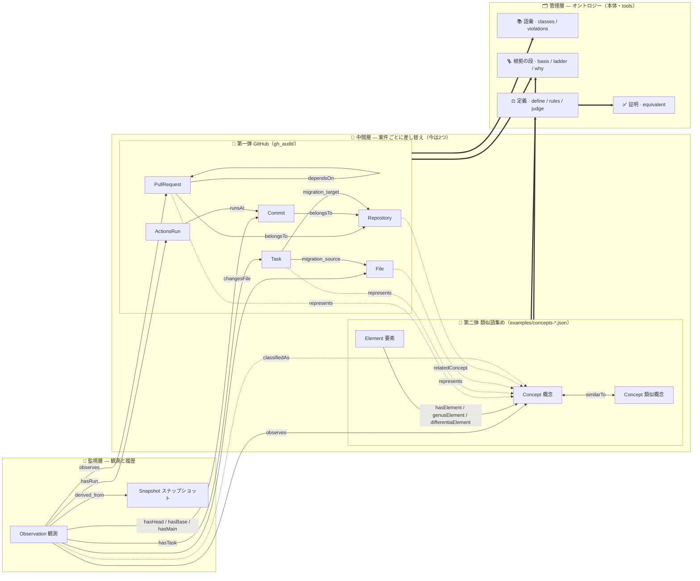
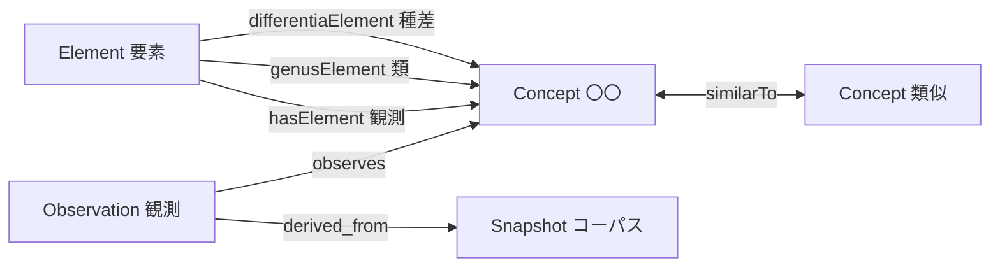
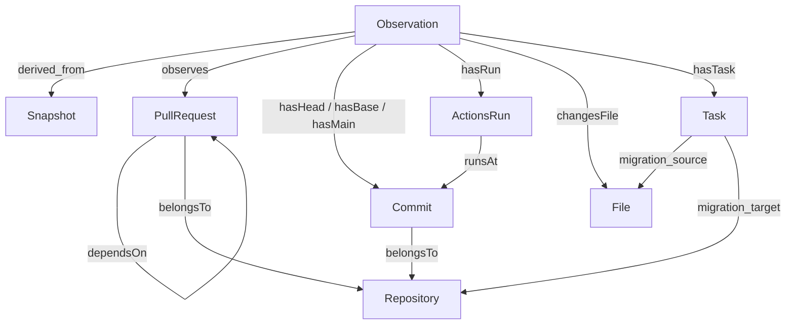

# OnTautoLogy

オントロジーをトートロジーの水準まで持っていく、小さなナレッジグラフです。主張は 🤔 候補 → 🧮 規則で導出 → 👀 観測 → ✅ 証明 の段を上り、最上段は「見ていない場合も含めて常に成り立つ」＝トートロジーです。Python 3.11 以降の標準ライブラリだけで動き、取得・書き込み・マージ・CI 起動・LLM 呼び出しは行いません。

## 🧭 2つの用途

| | 問い | 置き場 | 例データ |
| --- | --- | --- | --- |
| 🧩 第二弾 | 〇〇は何の要素があれば〇〇として成立するか。「〇〇は🔳🔳の類似」を集め、共通項と見分けから定義を作る | `ontautology.py`（define・roundtrip）＋ `tools/tautology.py`（rules・judge・equivalent） | `examples/concepts-20261115.json` |
| 🔭 第一弾 | 多数のリポジトリの PR を、観測の履歴ごと1つのグラフで見る（親の監査ダッシュボード向け） | `gh_audit/gh_audit.py` | `examples/audit-20261114.json`・`examples/flutter-absorption.json` |

どちらも同じ芯（辿る・循環・順序・根拠の段・鍵の昇格）の上に乗っています。Aoi の命題（逆・裏・対偶と判例）や TalkCompress の往復・判定モデルの延長線です。

## 🧭 全体図（監視・中間・管理の3層）



| 層 | 役目 | 今あるもの |
| --- | --- | --- |
| 👀 監視層 | いつ・何を見たか（観測と履歴） | Observation・Snapshot（🔭 第一弾と 🧩 第二弾で共通。同じ関係 `observes`・`derived_from` を使い、`digest`・`timestamp` は本体にある） |
| 🔁 中間層 | 案件ごとの実体。ここだけを差し替える | 🔭 第一弾 GitHub（`gh_audit/`）・🧩 第二弾 類似語集め（`concept_edges` と `examples/concepts-*.json`） |
| 🗂️ 管理層 | どの案件にも使うオントロジー | 📚 語彙の検査・🪜 根拠の段・⚖️ 定義・✅ 証明（本体と tools） |

| 線 | 意味 |
| --- | --- |
| ── 実線 | 今のコードにある関係（🔭 は `gh_audit.RELATIONS`、🧩 は `concept_edges`） |
| ══ 太線 | 管理層の関数で扱う（実装済み。🔭 は `validate` が `violations` を使い、🧩 は `define`・`rules` で定義を出す） |
| ┄┄ 点線 | 中間層どうしをつなぐ関係の設計案（`represents`・`relatedConcept`・`classifiedAs`）。まだ実装していない |

- 🔁 **案件を足すときは中間層を1つ足します。** 🔭 第一弾のやり方にならい、案件ごとにフォルダを切って語彙（`RELATIONS`）と読み込み・コマンドを置き、本体の口 `main(commands=..., load=...)` に差し込みます。語彙を引数で受ける `tools/ontology.violations` で検査できるので、管理層（本体と tools）は変えずに済みます。
- 🧪 **図とコードがずれないようにしています。** 実線の関係はコードの語彙にあること、点線の関係はまだ無いこと、中間層の2つの枠にそれぞれの語彙のクラスだけが入っていることをテストで確かめます。点線を実装したら、図も実線に直さないとテストが落ちます。

## 📂 構成

```
ontautology.py          🧠🧩 本体（汎用だけ・標準ライブラリのみ。これ1本を vendor すれば動く）
tools/
  tautology.py          🧩⚖️ 第二弾の判定（規則・可逆な定義・真理値表）、証明の段までの距離
  ontology.py           📚 語彙の違反を全部挙げる・鍵に昇格できる属性の組
  knowledgegraph.py     🕸️ 親の fleet コードと同じ名前・形の答え
gh_audit/               🔭 第一弾だけのフォルダ（第一弾の enhancement はここへ）
  gh_audit.py           🔭 第一弾: GitHub 監査（PR 監査・plan・diff・Turtle・Flutter 移管台帳）
vendor/                 📦 親から借りるもの（vendor.lock.json で SHA 固定）: py_launch.cjs・fleet_check.py
examples/               🌱 第二弾の類似コーパス、第一弾の監査スナップショット・移管台帳
tests/                  🧪 unittest（Redis の答え合わせは任意）
```

依存は 🔭 第一弾（gh_audit）→ 🧰 tools → 🧠 本体 の一方向です。🔭 第一弾は `gh_audit/` に閉じていて、本体と tools は gh_audit を読みません（テストで固定）。🧩 第二弾は汎用なので本体と `tools/tautology.py` にあります。

## 🚀 すぐ試す

```sh
# 🧩 第二弾
python -S tools/tautology.py rules examples/concepts-20261115.json             # ⚖️ seeds の〇〇ごとに規則を判定し、可逆な定義を出す
python -S tools/tautology.py judge examples/concepts-20261115.json ギター '["AND", "弦楽器", "撥弦", "フレット"]'   # 🧮 1本の規則の FN・FP
python -S tools/tautology.py equivalent '["NOR", "a", "b"]' '["AND", ["NOT", "a"], ["NOT", "b"]]'          # ✅ 書き換えが全通りで同じか
python -S tools/tautology.py holdout examples/concepts-20261115.json           # 🙈 初見・🎭 マスクで定義を測る
python -S tools/tautology.py guess examples/concepts-20261115.json --lies 1     # 🎯 当てっこ（食い違いを1回まで許す）
python -S ontautology.py define examples/concepts-20261115.json ギター ピカチュウ 鮭 iPhone エナジードリンク ルイージ   # 🧩 類と種差
python -S ontautology.py roundtrip examples/concepts-20261115.json カフェイン含有 飲料                     # 🔁 要素 → 語の往復

# 🔭 第一弾（gh_audit/）
python -S gh_audit/gh_audit.py audit examples/audit-20261114.json -o graph.json   # スナップショット → グラフ（複数渡すと履歴）
python -S gh_audit/gh_audit.py plan  graph.json                                  # main 未導入の PR の依存順
python -S gh_audit/gh_audit.py transfers examples/flutter-absorption.json        # Flutter の未吸収機能

python -S -m unittest discover -s tests
```

Node からは親の起動役を通します（ツールごとの `.mjs` / `.cjs` は置きません）。

```sh
node vendor/py_launch.cjs -- ontautology.py define examples/concepts-20261115.json ギター
node vendor/py_launch.cjs -- tools/tautology.py rules examples/concepts-20261115.json
node vendor/py_launch.cjs -- gh_audit/gh_audit.py audit examples/audit-20261114.json -o graph.json
node vendor/py_launch.cjs --call equivalent -- tools/tautology.py '["NOR","a","b"]' '["AND",["NOT","a"],["NOT","b"]]'   # 関数を名前で
```

`uv tool install .`（または `uv tool install git+https://github.com/myon-bioinformatics/OnTautoLogy.git`）で入るのは本体の `ontautology` コマンドです。tools と gh_audit はチェックアウトから使います。

## 🗂️ オントロジーを並べて見る

| | 🧩 第二弾（本体・`tools/tautology.py`） | 🔭 第一弾（`gh_audit/`） |
| --- | --- | --- |
| 入力 | `ontautology-concepts/1`（seeds・similar・concepts） | `integration-audit/3`（監査スナップショット） |
| 👀 監視層 | Observation（観測した概念ごと）・Snapshot（コーパスごと） | Observation（PR ごと）・Snapshot（スナップショットごと） |
| 語彙の置き場 | `ontautology.concept_edges` | `gh_audit.RELATIONS`（domain と range） |
| 芯の辺への写し | `concept_edges` | `edges_of` |
| 検証 | `check` | `check` ＋ `tools/ontology.violations` ＋ 監査固有の規則 |
| 手順 | ⚖️ `rules`（〇〇の定義） | 🪜 `plan`（PR の統合順序） |
| 証明の段 | ✅ `equivalent` が埋める | まだ 0 本 |

下の2つの表は、クラスと「そのクラスから出ていく関係 → 先のクラス」をすべて並べたものです。コードの語彙と1つでもずれるとテストが落ちます。

### 🧩 第二弾のクラスと関係

| クラス | 識別子 | 出ていく関係 → 先 |
| --- | --- | --- |
| `Observation` | `observation:` コーパスの digest ＋ `concept:` 語 | `observes` → Concept・`derived_from` → Snapshot |
| `Snapshot` | `snapshot:` コーパスの digest | — |
| `Concept` | `concept:` ＋ 語 | `similarTo` → Concept |
| `Element` | `elem:` ＋ 要素 | `hasElement` / `genusElement` / `differentiaElement` → Concept |



向きは芯と同じで、要素（依存される側）→ 概念（要素が変わったら見直す側）です。監視層は第一弾と同じ形で、コーパス1つが Snapshot（中身の digest なので入力の並び順では変わらない）、要素を見た概念ごとに Observation が1つできます。`hasElement` はその観測を `lock`（主張した記録）として持ち、`captured_at` があれば `observed_at` に入ります。要素が未観測（`null`）の概念には観測がありません。`hasElement` は観察の段（observed）、`genusElement`・`differentiaElement` は `define` の結果（derived、類似先が未観測なら hypothesis）です。

### 🔭 第一弾のクラスと関係

| クラス | 識別子 | 出ていく関係 → 先 |
| --- | --- | --- |
| `Observation` | `observation:` スナップショット digest ＋ PR | `hasRun` → ActionsRun・`targetsBranch` → Branch・`hasBase` / `hasHead` / `hasMain` → Commit・`hasCompletion` → CompletionRecord・`hasEvidence` → Evidence・`missingEvidence` → EvidenceGap・`changesFile` / `updates` → File・`hasPin` → FixedSHA・`hasGeneratedArtifact` → GeneratedArtifact・`hasIssue` → Issue・`missingFromMain` → MainGap・`observes` / `targets` → PullRequest・`hasReview` → Review・`derived_from` → Snapshot・`hasTask` → Task |
| `PullRequest` | `pr:` リポジトリ ＋ PR 番号 | `integrates_into` → Branch・`verified_by` → Evidence・`has_status` → Observation・`blocks` / `dependsOn` / `depends_on` / `duplicates` / `overlapsWith` → PullRequest・`belongsTo` → Repository |
| `Repository` | `repo:` owner/name | `has_status` → Observation・`same_as` → Repository |
| `Snapshot` | `snapshot:` digest | `supersedes` → Snapshot |
| `Commit` | `commit:` リポジトリ ＋ 完全 SHA | `belongsTo` → Repository |
| `Branch` | `branch:` リポジトリ ＋ ブランチ名 | `belongsTo` → Repository |
| `File` | `file:` リポジトリ ＋ 相対パス | `belongsTo` → Repository |
| `ActionsRun` | `run:` リポジトリ ＋ run ID ＋ attempt | `runsAt` → Commit・`hasJob` → Job・`belongsTo` → Repository |
| `Job` | `job:` run ＋ attempt ＋ job ID | — |
| `Task` | `task:` 観測（または台帳）＋ キー | `verifiesCommit` → Commit・`migration_source` → File・`has_status` → Observation・`migration_target` → Repository・`precedes` → Task |
| `CompletionRecord` | `completion:` 観測 ＋ digest | `verifiesCommit` → Commit |
| `FixedSHA` | `fixedsha:` 観測 ＋ digest | `pinsCommit` → Commit |
| `GeneratedArtifact` | `generatedartifact:` 観測 ＋ digest | `generatedFrom` → Commit |
| `Issue` | `issue:` 観測 ＋ digest | `belongsTo` → Repository |
| `Review` | `review:` 観測 ＋ digest | — |
| `Evidence` | `evidence:` 観測 ＋ digest | — |
| `EvidenceGap` | `evidencegap:` 観測 ＋ digest | — |
| `MainGap` | `main-gap:` 観測 | — |



## 🪜 手順を並べて見る（rules と plan）

| 段 | 🧩 第二弾 `rules`（〇〇の定義） | 🔭 第一弾 `plan`（統合順序） |
| --- | --- | --- |
| 1 集める | 類似と要素（`similar`・`concepts`） | PR ごとの観測（スナップショット、複数なら履歴） |
| 2 選ぶ | `seeds` の〇〇とその類似 | PR ごとに最新の観測（同時刻の矛盾はエラー） |
| 3 組む | 類 AND ・ NOR / NAND 類似の固有 ・ OR 種差 ・ 全要素 | main 未導入の PR と `dependsOn` |
| 4 当てる | 全概念に当てて FN・FP | 芯の `order`（graphlib） |
| 5 止める | FP・FN → `refuted`、未観測 → `to_model` | 循環・その下流・未観測の依存先 → `blocked` |
| 6 答える | 可逆な最初の規則 = 定義（`derived`） | 依存の順（CI・レビュー・競合は別に確認） |
| 7 確かめる | `holdout`: 概念を1つ隠して作り直し、隠した概念で測る（🙈 初見）・要素を1つ隠して測る（🎭 マスク）。`guess`: 何問で当たるか（🎯 当てっこ） | ➖ |
| 終了コード 2 | 可逆な定義が無い〇〇がある | ブロック・循環・棚卸しが不確か |

どちらも「見ていないものを完了・成立と読まない」点が同じです。未観測は第二弾では `to_model`、第一弾では `blocked` に残ります。

## 🧰 tools を並べて見る

本体の芯を組み合わせて、名前の意味（オントロジー → トートロジー）に沿った問いに答えます。実装を二重に持たず、芯を呼ぶだけです。

| ファイル | 関数 | 🧩 第二弾で | 🔭 第一弾（`gh_audit/`）で |
| --- | --- | --- | --- |
| ⚖️ `tautology.py` | `holds` `judge` `rules` `holdout` `guess` `guess_report` `equivalent` | 規則での判定・定義・初見とマスクでの評価・当てっこ・真理値表（CLI あり） | ➖ |
| ✅ `tautology.py` | `standing` `gaps` `entailed` | 定義が立つ段・証明未満の辺 | 監査の辺が立つ段・証明未満の辺 |
| 📚 `ontology.py` | `classes` `violations` `identity` | 鍵に昇格できる属性の組（種差と同じ考え方） | 語彙の検査（`validate` が使う）・クラス一覧 |
| 🕸️ `knowledgegraph.py` | `relation_cycles` `topological_order` | ➖ | 親の `fleet_records` / `vendor_fleet_plan` と同じ名前・形 |

## 📊 例データでの結果を並べて見る

どちらも同じ芯のコマンドで問えます（🧩 第二弾は `python -S tools/tautology.py`、🔭 第一弾は `python -S gh_audit/gh_audit.py` に続けて実行）。

| 問い | 🧩 第二弾 `examples/concepts-20261115.json` | 🔭 第一弾 `examples/audit-20261114.json` |
| --- | --- | --- |
| グラフ | 132 ノード・286 辺（Element 97・Concept 17・Observation 17・Snapshot 1） | 720 ノード・2,342 辺（File 542・ActionsRun 93・Commit 32・PullRequest 15・Observation 14 ほか） |
| `check` | 所見なし | 所見なし |
| `reach` | `elem:カフェイン含有` → エナジードリンク・コーヒー | `file:myon-bioinformatics/Aoi:README.md` → 159 ノード（PR 12） |
| `ladder` | 観測 198・導出 84・候補 4・証明 0 | 観測 2,292・導出 50・候補 25・証明 0 |
| 手順 | `rules`: 6 つの〇〇すべてに可逆な定義（終了コード 0）。`holdout`: 初見の誤り 4/96。`guess`: 17 概念すべて平均 3.5 問で当たる | `plan`: 順序 5・ブロック 1（`SakAnalytics#45` が未観測の `#44` を待つ。終了コード 2） |

🔭 の例は 2026年11月14日 23:12 JST の監査から抜き出した履歴（8 リポジトリ、観測した PR は 14 件）で、今の GitHub の状態ではありません。

## 🧩 第二弾: 類似から定義を作る（本体・`tools/tautology.py`）

### 📥 集めるもの

```json
{
  "schema": "ontautology-concepts/1",
  "seeds": ["ギター", "ピカチュウ", "鮭", "iPhone", "エナジードリンク", "ルイージ"],
  "similar": [{"left": "ギター", "right": "ベース", "basis": "observed"}],
  "maybe": {"ギター": ["金属弦"]},
  "concepts": {
    "ギター": ["楽器", "弦楽器", "撥弦", "フレット", "ボディ", "6弦標準", "中高音主体"],
    "ベース": ["楽器", "弦楽器", "撥弦", "フレット", "ボディ", "4弦標準", "低音主体"]
  }
}
```

- 🌱 `seeds`: 定義したい〇〇。増やすときは `seeds` と `similar`・`concepts` に足すだけです。
- 🔗 `similar`: 「〇〇は🔳🔳の類似」。1つの〇〇に何本でも足せます。`[left, right]` の短い形も可。
- 🤷 `maybe`: 外れているかもしれない紐付け（人がうろ覚えで付けるようなもの）。根拠の段は `hypothesis` で、定義や判定には使わず、当てっこで食い違っても減点しません。
- 🧺 `concepts`: 観察した要素。まだ見ていない概念は `null`（判定モデルへ回る）。値を持つ要素は `開放弦:EADGBE`・`進化の段:たね`・`種族値合計:320` のように「属性:値」で書くと、値が違うことがそのまま見分けになります。

### 🔄 流れ


TalkCompress の判定モデルと同じ分け方で、まず規則が決め、規則で決められないものだけを判定モデル（LLM）に回します。OTL 自身は LLM を呼びません。

### 📊 6つの〇〇の定義

`examples/concepts-20261115.json`（17 概念、類似 10 組、seeds 6）で `rules` を実行した結果です。ギターには類似を4つ（ベース・ウクレレ・三味線・バイオリン）と、類似ではないのに類が同じになる紛らわしい相手（ピアノ）を、ピカチュウには類似をもう1つ（ピチュー）入れています。本当に見分けている属性として、弦楽器には開放弦、ピカチュウの進化の並び（ピチュー → ピカチュウ → ライチュウ）には進化の段と種族値（各値と合計）を足しています。

| 〇〇 | 類似 | 類（共通項） | 定義 = 類 ∧ … | 「類だけ」の精度（FP） |
| --- | --- | --- | --- | --- |
| 🎸 ギター | ベース・ウクレレ・三味線・バイオリン | 楽器・弦楽器・ボディ | OR(6弦標準, 開放弦:EADGBE) | 0.71（ベース・ウクレレ・三味線・バイオリン・ピアノ） |
| ⚡ ピカチュウ | ライチュウ・ピチュー | ポケモン・でんきタイプ・ねずみ分類 | OR(種族値 HP:35・こうげき:55・すばやさ:90・とくこう:50・とくぼう:50) | 0.88（ライチュウ・ピチュー） |
| 🐟 鮭 | サクラマス | 魚類・サケ科・サケ属・遡河回遊魚・食用 | NOR(桜色の婚姻色, 降海型ヤマメ(O.masou)) | 0.94（サクラマス） |
| 📱 iPhone | Android | スマートフォン・タッチパネル・アプリ実行環境・モバイル通信 | NOR(Google系OS, 複数メーカー採用) | 0.94（Android） |
| 🥤 エナジードリンク | コーヒー | 飲料・カフェイン含有・覚醒目的 | NOR(焙煎豆, 抽出液, 苦味) | 0.94（コーヒー） |
| 🟢 ルイージ | マリオ | 任天堂・ゲームキャラクター・人間・配管工・帽子・オーバーオール | NOR(兄, 赤色) | 0.94（マリオ） |

- 「類だけ」の規則は毎回その類似を通してしまいます（FP）。
- 類似が1つなら、類似にしかない要素を NOR で除けば可逆になります。
- ギターは類似を増やして類が 楽器・弦楽器・ボディ に絞られ、さらにピアノが類だけを共有するので、NOR では足りず「6弦標準」か「開放弦:EADGBE」という見分けが要るようになりました。
- 種差の候補は、いちばん短いものだけを OR でつなぎます（ピカチュウの種族値のように多いときは最大5つ）。長い種差は他と共有する要素の組み合わせで、初めて見る相手を通しやすいためです。
- 同点の候補が並んだときは、全要素を並べただけの規則より、類から組んだ規則を先にします。

### 🙈 初見と 🎭 マスク（`holdout`）

集めたものでだけ満点になる定義を見抜くための測り方です。ナレッジグラフ・オントロジーでは、いずれ初めて見るデータや欠けた観測に向き合うので、最初から測ります。

| 測り方 | やること | 数えるもの |
| --- | --- | --- |
| 🙈 初見 | 他の概念を1つ隠して定義を作り直し、隠した概念に当てる | 隠した概念を通してしまった数（FP） |
| 🎭 マスク | 〇〇自身の要素を1つ隠して、元の定義に当てる | 〇〇を認められなくなった数（FN） |

| | 初回（類似1つずつ、12 概念） | 類似と紛らわしい相手を増やす（17 概念） | ＋見分ける属性・最短の種差だけ |
| --- | --- | --- | --- |
| 🙈 初見の誤り | 6 / 66（9.1%） | 6 / 96（6.3%） | 4 / 96（4.2%） |
| 🎭 マスクで落ちる | 26 / 40（65%） | 25 / 40（62.5%） | 24 / 49（49%） |
| ✂️ 定義の要素数（平均） | 6.5 | 6.0 | 6.7 |

- 🙈 **初回の満点は見かけでした。** 6つの〇〇すべてで、いちばん近い類似を隠すと、作り直した定義がそれを通しました。類似を増やすだけでは、ギターは隠したウクレレを、ピカチュウは隠したピチューを通したままでした。
- ⚡ **ピカチュウは、本当に違う属性で直りました。** 進化の段と種族値を入れると、種族値の値が違うので、隠したピチューを弾けます。種族値が1つ欠けても他で認められるので、マスクにも強くなりました。
- 🎸 **ギターは、OR を最短の種差だけにして直りました。** ウクレレを隠すと、`中高音主体 ∧ 撥弦` のような長い種差まで OR でつながり、ウクレレがその枝で通っていました。最短の `6弦標準`・`開放弦:EADGBE` だけにすると弾け、2つあるので片方が欠けても認められます。
- 🎭 **マスクに弱いのは AND です。** 類として AND で並べた要素は、1つ欠けるだけで落ちます。
- 🐟 **残る4件は、類似が1つしかない〇〇です。** 鮭・iPhone・エナジードリンク・ルイージは、その1つを隠すと比べる相手がいなくなります。

### 🎯 当てっこ（`guess`）

ヌメロンやワードウルフのように、問い合わせの回数で正解に着けるかを測ります。厳しく見分けられるかより、「人が当てっこするときのように、少ない質問で着くか」を見ます。

- ❓ **質問は2種類です。** 「その要素がある？」（はい／いいえ）と、`属性:値` の要素に対する「開放弦は？」のような値で返る質問です。値で返る分、ヌメロンのように二択より多くを1問で知れます。
- ✂️ **毎回、残った候補をいちばん均等に割る質問を選びます。** 見込みは二択で理想的に割れたときの回数（log₂ 候補数）です。
- 🧍 **人間らしい失敗を許せます。** `--lies N` で、食い違いを N 回までは候補を残します。`maybe` の紐付けは食い違っても減点しません。

`examples/concepts-20261115.json`（17 概念、二択での見込み 5 問）の結果です。

| 許す食い違い | 😊 正直に答える | 🎭 1つ忘れる | 🙈 知らない相手を出す |
| --- | --- | --- | --- |
| 0 回 | 17 / 17 当たる・平均 3.5 問（最大 6） | 120 / 144 当たる（83%） | 8 / 17 で「知らない」と言えた（47%） |
| 1 回 | 17 / 17 当たる・平均 7.5 問（最大 11） | 144 / 144 当たる（100%） | 3 / 17（18%） |

- ⚡ **正直なら見込みより少ない問いで着きます。** 「開放弦は？」「種族値HPは？」のような値で返る質問が効いています。ギターもピカチュウも2問です。
- 🎭 **忘れても当てたいなら、食い違いを許します。** その代わり質問は倍になり、知らない相手を近い誰かと取り違えやすくなります。人間の当てっこと同じ引き換えです。
- 🙈 **知らない相手で取り違えるのは、`holdout` と同じ所です。** 鮭を知らないと、サクラマスと答えてしまいます（類似1つの罠）。

### ⚖️ 判定の読み方

| 判定 | 意味 | 何が覆すか |
| --- | --- | --- |
| 命題（規則 → 〇〇）・対偶 | 規則が通すなら〇〇 | FP（他の概念を通した） |
| 逆（〇〇 → 規則）・裏 | 〇〇なら規則が通す | FN（〇〇を落とした） |
| `reversible` | FN も FP も 0、未観測もなし | 根拠の段は `derived` |
| `to_model` | 要素が未観測で規則では決められない | 判定モデルへ回す |
| `equivalent` | 2本の規則が真理値表の全通りで同じ | 根拠の段は `proof` |

規則は JSON の木で、`["AND", "弦楽器", ["NOR", "4弦標準", "低音主体"]]` のように AND・OR・NOT・NAND・NOR を入れ子にします。空の AND は常に真、空の OR は常に偽です。

### 🔁 往復と類・種差

- `define` は類似群の共通項（類）と、他の全概念から見分ける最小の要素の組（種差）を出します。
- `roundtrip` は要素の集合から元の語へ戻せるかを見ます。`カフェイン含有 飲料` はエナジードリンクとコーヒーの両方に当たり `collides`、`炭酸` を足すとエナジードリンクだけに戻ります（`unique`）。
- 反例（`6弦ベース` など）が来ると `collides` になり、最小識別鍵が組み替わります。類似先が未観測（`null`）や `basis=hypothesis` だけなら `derived` に上がりません。

### ⚠️ 限界と次

- `reversible` は集めた概念の範囲での話です。`holdout` の初見の誤りがその隙間です。
- 残る初見の誤りは、類似が1つしかない〇〇（鮭・iPhone・エナジードリンク・ルイージ）です。減らすには、類似をもう1つ以上集めるか、ピカチュウの種族値のように値で見分けられる属性を「属性:値」で足します。
- 種差が名前の言い換え（`白鮭(O.keta)`、`Apple製` など）になると定義が堂々巡りになります。これを見つける検査はまだありません。

## 🔭 第一弾: GitHub 監査（`gh_audit/`）

第一弾は `gh_audit/gh_audit.py` に閉じています。GitHub 固有のもの（リポジトリ・PR・コミット・run・job・タスク・移管）はここだけに置き、本体と tools には入れません。第一弾の enhancement はこのフォルダに足します。

入力は継続監査サイトの「統合証跡JSON」（`integration-audit/3`）です。観測 JSON の `{"aoi_integration": {...}}` で包まれた形も受け付けます。GitHub への取得・書き込みは行いません。

### 👀 観測の扱い

- 観測に取得日時・出典・作業状態・merged・mergeable・main 包含を残します。未取得は `null` のままで、false にしません。変更ファイルの未取得は `files_observed=false` で区別します。
- run は自分のコミット（`runsAt`）にだけ結び付けます。PR の head と同じだとは仮定せず、head が未取得の run にはコミットを作りません。attempt ごとに別のノードです。
- 同じリポジトリで変更パスが重なったときだけ `overlapsWith` を導出します（basis は derived）。Git の競合を意味しません。
- 依存は監査側の主張として取り込み、出典と観測 ID を関係に付けます。Turtle では `rdf:Statement` で表し、古い依存を今も有効な事実に昇格させません。
- `edges_of(graph)` が監査グラフを芯の辺に直します。`dependsOn` と `changesFile` は向きを返し、向きのない `overlapsWith` は両向きにします。循環と順序は `cycles GRAPH dependsOn`、`order GRAPH dependsOn` のように依存の辺だけで問います。

### 🪜 統合順序（`plan`）の補足

PR ごとに最新の観測を選び、`contained_in_main=true` の依存先を消化済みとして、芯の `order` で順序を出します。merged だけでは main への導入を推定しません。未観測の依存先、循環、その下流は `blocked` に残し、独立した部分の順序は出します。同時刻に矛盾するスナップショットがあればエラーにします。順序は依存関係の制約だけで、CI・未解決レビュー・競合・保留の受入条件は監査ビューで確認します。

### 📋 open PR の棚卸し（任意）

`open_pr_inventory` は任意のトップレベル配列です。無い入力は従来どおりに計画します。空配列は「どのリポジトリも範囲に含めない」という宣言で、「どこも PR がゼロ」ではありません。各要素は owner/name 1つに対応します。

```json
{"repository":"myon-bioinformatics/Ironmate","checked_at":"2026-11-15T12:00:00Z",
 "complete":true,"open_pr_numbers":[]}
```

- ✅ 完全な要素は、重複のない正の PR 番号（Draft を含む）を並べます。`[]` は、その確認時点でそのリポジトリに open PR が無いことを明示します。取得失敗や部分取得は `"complete":false,"open_pr_numbers":null` で、空配列にはしません。
- 📸 入力ごとに `Snapshot` ノードを作ります（records が無くても）。digest・観測時刻・明示の棚卸しを残し、`derived_from` で PR の観測とつなぎます。Turtle では構造化メタデータを JSON テキストの文字列リテラルにします。
- 🪜 `plan` はリポジトリごとに最新の `checked_at` を使います（不完全でも）。範囲が不完全なら古い PR を予定に入れず `inventory_uncertainty` を返します。完全な範囲がメンバーを決めますが、並んだ PR には同じスナップショットの行が必要で、無ければ `missing_rows` と `blocked` に出ます。古い証跡を今の証跡に昇格しません。同時刻の矛盾は ambiguous として拒否します。
- 🚫 消えたことは完了ではありません。依存先が見えなくなっても、観測で `contained_in_main: true` が確かめられない限り下流をブロックします。履歴のノードと証跡は消しません。不完全な棚卸しでは `plan` の終了コードは 2 です。これは依存の計画であって、マージの許可や CI の判定ではありません。

### 📦 Flutter の未吸収機能

`examples/flutter-absorption.json` に、固定 SHA の元ファイル、移管先候補、受入条件、検証 SHA・Actions 証跡を記録します。初期登録は主要機能 12 群と追加要望 2 件で、全パターンの棚卸し完了や吸収完了は意味しません。アーカイブ後も元 SHA への紐付けを保ち、Flutter の active 監視とは分けます。

- `transfers` は未完了または棚卸し範囲が未確定なら終了コード 2、入力不整合なら 1 です。
- `state=完了` には、元 SHA と移管先 SHA に一致する receipt、移管先ファイル、main 反映の記録、全受入条件の ID、移管先の Actions URL が必要です。これは記録の整合性検査で、CI 結果・main 包含・機能同等性の独立検証ではありません。移管先が未決でも `target.repository=null` で残せます。
- 機能は Task として `migration_source`（元 File）・`migration_target`（移管先 Repository）に結び、5 状態と Snapshot・Evidence を保ちます。追加要望は `kind=request` で既存機能の未吸収と区別します。

監査の入力には「常に成り立つ」と言える関係がないので、証明の段は 0 本です。第二弾の `equivalent` のように、他で証明された関係を辺として渡したときに埋まります。

## 🧠 共通の芯

### 🪜 根拠の段

| basis | 意味 |
| --- | --- |
| `hypothesis` | 誰も確かめていない候補。`reach` は候補として示すだけで、その先へ進まない |
| `derived` | 記録に対する決まった規則（同じ変更パス、名前の一致、集めた概念での可逆な定義など） |
| `observed` | 記録から読んだ。見ていないものについては何も言わない（省略時の既定） |
| `proof` | 見ていない場合も含めて常に成り立つ。ここがトートロジーの段 |

`why` は辿った道で一番弱い段（`weakest`）を返すので、途中に候補が1つあれば証明済みとは読めません。

### 🔗 芯の辺

`{"kind", "source", "target"}` に、呼び出し側が持つもの（`basis`、主張している記録 `lock`、記録自身の時刻 `observed_at` など）を足した dict です。向きは **source = 依存される側 → target = source が変わったら見直す側**。前向きに辿れば影響先、後ろ向きに辿れば根拠です。

| 関数 | 答えること |
| --- | --- |
| `check(edges, nodes=None)` | 形の崩れ、未知の basis、存在しない参照、同じ記録・同じ時刻の主張で中身が違うもの。直さず報告する |
| `reach(edges, start)` | 変更が届く先。深さ・経路・その辺。DAG を仮定しない |
| `why(edges, node)` | 判断が拠っているもの。`cut` は深さ制限で読み残したこと |
| `cycles(edges)` | 循環の代表例。報告するだけで止めない |
| `order(edges, nodes=())` | 「先に必要」の辺から、並行できる組を順に返す（graphlib）。循環とその下流は `blocked`、残りは順序を出す |
| `ladder(edges)` | 段ごと・種類ごとの本数 |
| `key_report(items, candidates)` | 属性の組が鍵になるか: `key` / `repeat` / `collides` / `incomplete` |

同一性は最後に決まります。意味を持たない取っ手を振り、観測を足し、区別できないものをまとめ、新しい観測で割れることを許し、欠けがなく一意な属性の組だけを鍵に昇格させ、衝突は上書きせず報告します。`key_report` はその最後の2段で、第二弾の種差も同じ考え方です。

### ⌨️ コマンド

🧠 共通の芯 — `ontautology.py`（どの CLI からも使える）

| コマンド | 入力 | 答え |
| --- | --- | --- |
| 🧪 `check` 💥 `reach` 🔎 `why` 🔁 `cycles` 🪜 `order` `ladder` | どれでも | 所見・影響先・根拠・循環・順序・段ごとの本数 |
| 🔑 `keys GRAPH FIELDS...` | `"items"` を持つ JSON | 属性の組（`id+run` など）が鍵になるか |

🧩 第二弾 — `ontautology.py`（define・roundtrip）と `tools/tautology.py`（rules・judge・equivalent）

| コマンド | 入力 | 答え |
| --- | --- | --- |
| ⚖️ `rules CORPUS [CONCEPT...]` | 類似コーパス | 〇〇ごとの規則の候補と判定、可逆な定義（既定は `seeds`） |
| 🧮 `judge CORPUS CONCEPT RULE` | 類似コーパス | 1本の規則の FN・FP・精度・命題／逆／裏／対偶 |
| 🙈 `holdout CORPUS [CONCEPT...]` | 類似コーパス | 🙈 初見（概念を隠して作り直す）と 🎭 マスク（要素を隠す）での誤り。初見の誤りがあれば終了コード 2 |
| 🎯 `guess CORPUS [CONCEPT...] [--lies N]` | 類似コーパス | 当てっこ: 何問で当たるか（正直・1つ忘れる・知らない相手）。正直に答えて当たらない〇〇があれば終了コード 2 |
| ✅ `equivalent RULE RULE` | 規則2本 | 全通りで同じか（`proof`）、違う場合の反例 |
| 🧩 `define CORPUS [CONCEPT...]` | 類似コーパス | 類・種差・往復判定 |
| 🔁 `roundtrip CORPUS ELEM...` | 類似コーパス | 要素をすべて満たす概念（一意・衝突・空） |

🔭 第一弾 — `gh_audit/gh_audit.py`

| コマンド | 入力 | 答え |
| --- | --- | --- |
| 🔭 `audit FILE...` | 監査スナップショット | グラフ（`--format turtle` で RDF） |
| 🪜 `plan GRAPH` | 監査グラフ | main 未導入の PR の依存順・ブロック・未観測の依存先 |
| 🆚 `diff BEFORE AFTER` | 監査グラフ2つ | 追加・削除・変化した PR |
| 🐢 `turtle GRAPH` | 監査グラフ | RDF/Turtle |
| 📦 `transfers LEDGER` | 移管台帳 | 未吸収・移管先・受入の整合性 |

`tools/tautology.py` と `gh_audit/gh_audit.py` は本体の口 `main(commands=..., load=...)` に自分のコマンドを足すので、🧠 のコマンドもそのまま使え、CLI・標準入力の決まり・終了コードは1つです。「どれでも」は類似コーパス・素の `{"edges": [...], "nodes": [...]}`・（🔭 第一弾の CLI なら）監査グラフです。全コマンドに `-o FILE` があり、ファイル名を `-` にすると標準入力の UTF-8 JSON を読みます（1コマンドにつき1回）。

終了コード: `0` 答えた / `1` 入力エラー / `2` 答えたが要確認（所見・循環・ブロック・未知のノード・鍵にならない・差分あり・定義の衝突や未観測・可逆でない・同値でない）。`2` は道具の失敗ではなく、入力についての答えです。

### 🐍 Python・Node から呼ぶ

```python
import ontautology as ot
from tools import tautology
from gh_audit import gh_audit

tautology.rules(corpus, "ギター")["definition"]       # 🧩 第二弾: 可逆な最初の規則
ot.define_concepts(corpus, ["ギター"])                 # 🧩 第二弾: 類と種差
gh_audit.plan(gh_audit.audit([snapshot]))             # 🔭 第一弾: 監査グラフ → 依存順
```

Node からは `vendor/py_launch.cjs` の `--call 関数名` で、`if __name__ == "__main__"` を通さずに関数を名前で呼べます（引数は1つずつ JSON）。大きな JSON は引数ではなく CLI のファイル入力か標準入力で渡します。GraphQL は取得側で `integration-audit/3` へ変換する境界で、本体から認証・HTTP を呼びません。Rust への切り出しは同じ JSON と終了コードを保つ案で、未実装・未測定です。

## 🧪 テスト

```sh
python -S -m unittest discover -s tests                     # 標準ライブラリだけ（Node 26+ があれば Node 経由も）
uv run --no-project --with redis python -m unittest discover -s tests -p test_tools.py -k RedisCrossCheck -v   # 🧱 Redis で答え合わせ
```

| ファイル | 対象 |
| --- | --- |
| `test_ontautology.py` | 芯（辿る・循環・順序・所見・鍵・CLI） |
| `test_concepts.py` | 第二弾の類・種差・往復 |
| `test_tools.py` | tools（判定・可逆・真理値表・語彙・依存の向き）と Redis の答え合わせ |
| `test_gh_audit.py` | 第一弾の監査 |
| `test_fleet.py` | vendor のロック・Action の SHA 固定・Node 経由と Python の一致 |

🧱 `RedisCrossCheck` は、外部モジュールで先に考え方を確かめるための足場です。Redis の集合で同じ問い（`reach` の到達先、`key_report` の判定、規則が通す概念を `SINTER`・`SUNION`・`SDIFF` で、類と種差を `SINTER`・`SDIFF` で）を別に解き、乱数で作った入力すべてで本体と一致するかを見ます。`redis` パッケージか `redis-server` が無ければ skip し、CI の `redis` ジョブでだけ skip を失敗にします。サーバーは一時ディレクトリの unix socket で立て、ポートも保存も使いません。本体と tools は Redis を import しません。

## 🧭 置くもの・置かないもの

- 置く: 横断して見るためのグラフのロジック、類似から定義を作る判定、その用途としての GitHub 監査の読み取り。
- 置かない: GitHub や Git からの取得、各リポジトリ固有の記録形式の解釈、LLM の呼び出し、画面。それらは記録を書くリポジトリ・親（myon-bioinformatics）・TalkCompress の役目で、ここを呼ぶ側です。画面が要るときも HTML・CSS・JS は Python 側（`web_ui.py` など）で組みます。
- OWL 準拠は主張しません。SPARQL や GraphQL の代わりに、関数を名前で呼びます。

## 📝 方針メモ（たたき台）

リポジトリのあり方をルールとしてグラフに載せる案は、[docs/policy-rules.md](docs/policy-rules.md) にあります。実装ではなく、見直し前提の設計メモです。
