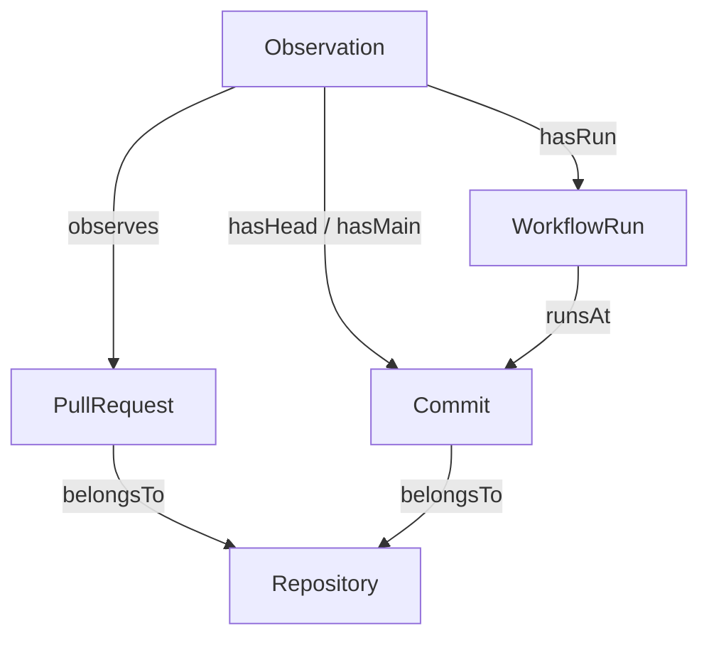

# OnTautoLogy

ナレッジグラフとオントロジーの小さな実験。最初の用途は PR 監査データの関係整理です。Python 3.11 以降の標準ライブラリだけで動きます。

```sh
python -S ontautology.py snapshot.json -o graph.json
python -S -m unittest -v
```

入力は継続監査サイトの `pr-audit-snapshot.json` 形式です。取得処理は含みません。出力は `Repository`、`PullRequest`、`File`、`WorkflowRun` と、それらの `belongs_to`、`changes`、`has_run`、`shares_changed_paths_with`、`depends_on` を持つ JSON です。`observed_at` と CI の対象 head SHA を保持します。

任意の `dependencies` に `{"dependent":"Aoi#211", "prerequisite":"BlueProbe#53", "evidence":"根拠へのURLなど"}` を追加すると、明示された依存だけから並行可能な統合順を算出します。循環は `dependency_cycle` に記録し、終了コード 2 を返します。入力エラーは 1、成功は 0 です。

変更パスの一致は競合や内容の一致を意味しません。未取得の変更ファイルは空と区別します。CI は入力にある観測のみで、古い head の結果や未取得を現在の成功と推定しません。PR がマージ済みかどうかと、再検証の完了は別です。GitHub の変更、CI 起動、マージは行いません。

初期のJSONモデルは軽量な語彙です。RDF出力は以下の拡張モードで提供します。依存関係は自動推測せず、証拠付きで入力してください。

## 観測履歴・RDF出力

リポジトリ監査の観測をナレッジグラフにする。Python 3.11以降、実行時の外部依存なし。

最初の対象は、PRの変更ファイル・依存・統合先・SHA・CI結果である。
既存の継続監査ビューが出力する `integration-audit/3` を読み込み、共通のJSONグラフとRDF/Turtleを生成する。
出力は実行時に生成し、HTML・CSS・JavaScriptや生成物は追加しない。

## 実行

```sh
python -S ontautology.py build examples/audit-20261114.json -o graph.json
python -S ontautology.py check graph.json
python -S ontautology.py plan graph.json
python -S ontautology.py turtle graph.json -o graph.ttl
python -S -m unittest -v
```

`examples/audit-20261114.json` は2026年11月14日23:12 JSTの監査から抜き出した履歴であり、現在のGitHub状態を示すものではない。
最新データは[継続監査サイト](https://myon-repository-audit.frolickingchameleon.chatgpt.site)の「統合証跡JSON」を取得して入力する。
複数時点を渡すと履歴を保持する。

```sh
python -S ontautology.py build before.json after.json -o history.json
```

インストールして使う場合：

```sh
uv tool install .
ontautology build examples/audit-20261114.json -o graph.json
uv tool upgrade ontautology
uv tool uninstall ontautology
```

実装は `ontautology.py` に集約。インストール時のwheel生成にsetuptoolsを使用する。

## オントロジー

クラスと関係の定義は `ontautology.py` の `CLASSES`・`RELATIONS` に集約し、JSONとTurtleへ同じ定義を出す。
関係の定義にはdomain（始点の型）とrange（終点の型）を持たせ、読込後に検証する。

| クラス | 識別子の範囲 | 主な関係 |
| --- | --- | --- |
| Repository | owner/name | 他の実体から belongsTo |
| PullRequest | リポジトリ＋PR番号 | dependsOn、overlapsWith |
| Observation | 入力スナップショットのdigest＋PR | observes、hasHead、hasBase、hasMain |
| Commit | リポジトリ＋完全SHA | belongsTo |
| Branch | リポジトリ＋ブランチ名 | Observationから targetsBranch |
| File | リポジトリ＋相対パス | Observationから changesFile |
| WorkflowRun | リポジトリ＋run ID＋attempt | runsAt、Observationから hasRun |



観測に取得日時・出典・作業状態・merged・mergeable・main包含を残す。
未取得の値は `null` を保持し、falseへ変換しない。変更ファイルの未取得は `files_observed=false` で区別する。
同一パスでもリポジトリが異なれば別のFileである。
同一リポジトリで変更パスが重なった場合だけ `overlapsWith` を導出する。これはGitの競合を意味しない。

依存は監査側で記録された主張として取り込み、出典と観測IDを関係へ付ける。
Turtleでは観測に依存する関係を `rdf:Statement` で表し、古い依存を現在も有効な事実へ昇格させない。
CIの結果もObservationとの関係に保持し、head/main・run・attemptを区別する。
通常CI成功、配布CI失敗、キャンセルを一つの成功フラグにまとめない。

## 統合順序

`plan` はPRごとの最新観測を選び、`contained_in_main=true` の依存先を消化済みとして `graphlib.TopologicalSorter` で順序を計算する。
mergedだけではmain導入を推定しない。
未観測の依存先、循環、その下流は `blocked` に残し、独立した部分の順序を出す。
同時刻に矛盾するスナップショットがある場合は、入力を選び直すためエラーにする。

順序は依存関係の制約だけを示す。CI、未解決レビュー、競合、保留の受入条件は監査ビューで確認する。
GitHubからの自動取得、書込み、マージ、CI起動は行わない。

## 入力エラー

終了コード2と短いエラーを標準エラーに出す。
まず `schema=integration-audit/3`、完全な40桁SHA、タイムゾーン付き `captured_at`、5種類の作業状態を確認する。
入力JSONが存在するディレクトリで実行するか、絶対パスを指定する。

このリポジトリへの初期追加は、既存の親・Aoi・子リポジトリの実装や監査サイトを変更しない。
