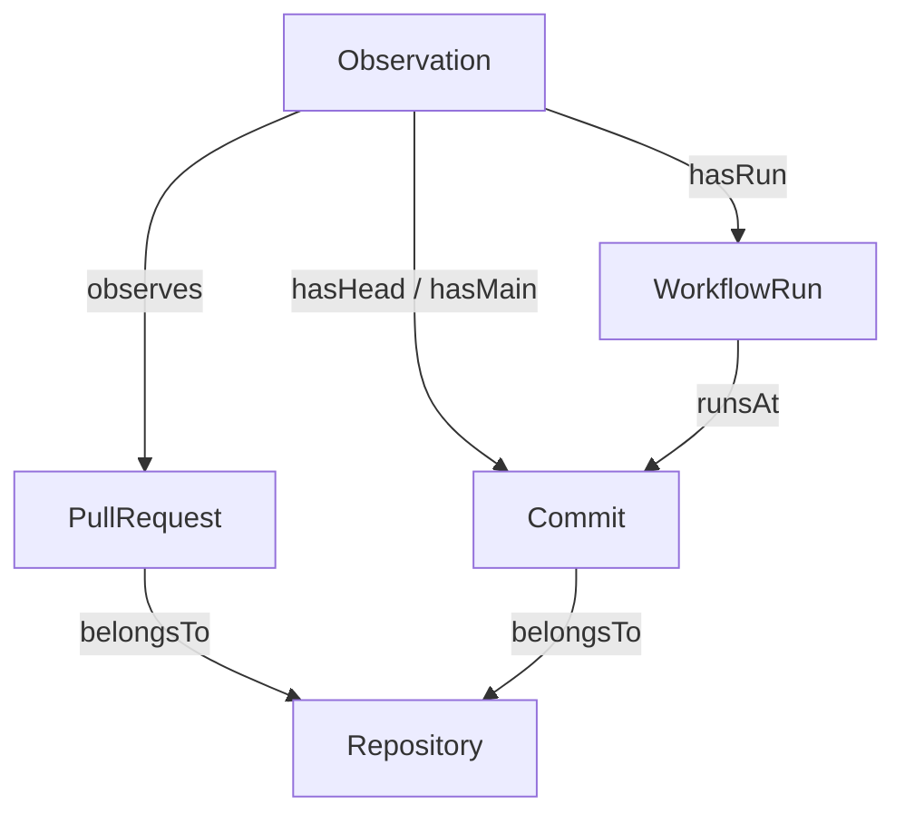

# OnTautoLogy

オントロジーをトートロジーの水準まで持っていく。複数のリポジトリを横断して見るための、小さなナレッジグラフです。Python 3.11 以降の標準ライブラリだけで動き、GitHub からの取得・書き込み・マージ・CI 起動は行いません。

実装は `ontautology.py` 1本、テストは `tests/` 以下（`test_ontautology.py` と `test_concepts.py`）です。

| 部分 | 役割 | 関数 |
| --- | --- | --- |
| 1. 🧠 芯 | どのグラフにも要るロジック。リポジトリを知らず、dict / list（JSON）だけを扱う | `check` `reach` `why` `cycles` `order` `ladder` `key_report` |
| 2. 🔭 横断監査 | 最初の用途。多数のリポジトリの PR 監査スナップショットを、観測の履歴を保った1つのグラフにする | `audit` `validate` `plan` `observation_diff` `turtle` `edges_of` |
| 3. 🧩 類似と定義 | 第二弾。類似ペア（`ギター↔ベース` など）から共通項（類）と最小識別鍵（種差）を抽出し、要素からの往復復元で衝突を検証する | `define_concepts` `roundtrip_elements` `concept_edges` |

チェックアウトしたディレクトリで `uv tool install .`、または `uv tool install git+https://github.com/myon-bioinformatics/OnTautoLogy.git` で導入できます。導入後は `ontautology snapshot.json -o graph.json` を実行できます。Python からは `from ontautology import build_graph` で呼び出せます。

```sh
python -S ontautology.py audit examples/audit-20261114.json -o graph.json   # 🔭 スナップショット → グラフ（複数渡すと履歴）
python -S ontautology.py plan   graph.json                                  # 🪜 main 未導入の PR の依存順
python -S ontautology.py reach  graph.json file:myon-bioinformatics/Aoi:README.md   # 💥 変更の影響先
python -S ontautology.py why    graph.json pr:myon-bioinformatics/Aoi#208          # 🔎 判断の根拠
python -S ontautology.py check  graph.json                                  # 🧪 形・参照・重複
python -S ontautology.py diff   before.json after.json                      # 🆚 最新観測どうしの差
python -S ontautology.py audit  examples/audit-20261114.json --format turtle -o graph.ttl   # 🐢 RDF/Turtle
python -S ontautology.py define examples/concepts-20261115.json ギター ピカチュウ 鮭 iPhone エナジードリンク  # 🧩 類似から定義抽出
python -S ontautology.py roundtrip examples/concepts-20261115.json カフェイン含有 飲料  # 🔁 要素→語の往復と衝突確認
python -S -m unittest discover -s tests
```

| コマンド | 入力 | 答え |
| --- | --- | --- |
| 🔭 `audit FILE...` | 監査スナップショット | グラフ（`--format turtle` で RDF） |
| 🪜 `plan GRAPH` | 監査グラフ | main 未導入の PR の依存順・ブロック・未観測の依存先 |
| 🆚 `diff BEFORE AFTER` | 監査グラフ2つ | 追加・削除・変化した PR |
| 🐢 `turtle GRAPH` | 監査グラフ | RDF/Turtle |
| 🧩 `define CORPUS [CONCEPT...]` | 類似コーパス | 類似ペアの共通項（類）・最小識別鍵（種差）・往復判定 |
| 🔁 `roundtrip CORPUS ELEM...` | 類似コーパス | 指定要素をすべて満たす概念（一意・衝突・空） |
| 🧪 `check GRAPH` | どれでも | 所見の一覧（監査グラフはオントロジーも検証） |
| 💥 `reach GRAPH NODE...` | どれでも | 変更が届く先 |
| 🔎 `why GRAPH NODE...` | どれでも | 判断の根拠 |
| 🔁 `cycles GRAPH [KIND...]` | どれでも | 循環の代表例 |
| 🪜 `order GRAPH [KIND...]` | どれでも | 並行できる組の順 |
| 🪜 `ladder GRAPH` | どれでも | 根拠の段ごとの本数 |
| 🔑 `keys GRAPH FIELDS...` | `"items"` を持つ JSON | 属性の組（`id+run` など）が鍵になるか |

「どれでも」は、監査グラフ、類似コーパス（`ontautology-concepts/1`）、素の `{"edges": [...], "nodes": [...]}` のすべてです。全コマンドに `-o FILE` があります。

終了コード: `0` 答えた / `1` 入力エラー / `2` 答えたが要確認（所見・循環・ブロック・未知のノード・鍵にならない・差分あり・定義衝突または未観測）。`2` は道具の失敗ではなく、入力についての答えです。

Python からは関数名で呼べます。Node からは Python ランチャー（`py_launch.cjs`）経由で呼ぶ前提で、JS の実装は置きません。画面が要るときも HTML・CSS・JS は Python 側（`web_ui.py` など）で組み、ここには足しません。`uv tool install .` で `ontautology` コマンドとしても使えます。

## 🪜 根拠の段

| basis | 意味 |
| --- | --- |
| `hypothesis` | 誰も確かめていない候補。`reach` は候補として示すだけで、その先へ進まない |
| `derived` | 記録に対する決まった規則（同じ変更パス、名前の一致など） |
| `observed` | 記録から読んだ。見ていないものについては何も言わない（省略時の既定） |
| `proof` | 見ていない場合も含めて常に成り立つ。ここがトートロジーの段 |

`why` は辿った道で一番弱い段（`weakest`）を返すので、途中に候補が1つあれば証明済みとは読めません。

## 🔗 芯の辺

`{"kind", "source", "target"}` に、呼び出し側が持つもの（`basis`、主張している記録 `lock`、記録自身の時刻 `observed_at` など）を足した dict です。向きは **source = 依存される側 → target = source が変わったら見直す側**。前向きに辿れば影響先、後ろ向きに辿れば根拠です。

| 関数 | 答えること |
| --- | --- |
| `check(edges, nodes=None)` | 形の崩れ、未知の basis、存在しない参照、同じ記録・同じ時刻の主張で中身が違うもの。直さず報告する |
| `reach(edges, start)` | 変更が届く先。深さ・経路・その辺。DAG を仮定しない |
| `why(edges, node)` | 判断が拠っているもの。`cut` は深さ制限で読み残したこと |
| `cycles(edges)` | 循環の代表例。報告するだけで止めない |
| `order(edges, nodes=())` | 「先に必要」の辺から、並行できる組を順に返す（graphlib）。循環とその下流は `blocked`、残りは順序を出す |
| `ladder(edges)` | 段ごと・種類ごとの本数 |
| `key_report(items, candidates)` | 属性の組が鍵になるか: `key` / `repeat` / `collides` / `incomplete` |

同一性は最後に決まります。意味を持たない取っ手を振り、観測を足し、区別できないものをまとめ、新しい観測で割れることを許し、欠けがなく一意な属性の組だけを鍵に昇格させ、衝突は上書きせず報告します。`key_report` はその最後の2段です。

## 🔭 横断監査のオントロジー

入力は継続監査サイトの「統合証跡JSON」（`integration-audit/3`）です。観測 JSON の `{"aoi_integration": {...}}` で包まれた形も受け付けます。クラスと関係は `ontautology.py` の `RELATIONS`（関係ごとの domain と range）だけで定義し、クラスの一覧はそこから導きます。JSON と Turtle へ同じ定義を出し、読込後に検証します。

| クラス | 識別子の範囲 | 主な関係 |
| --- | --- | --- |
| Repository | owner/name | 他の実体から belongsTo |
| PullRequest | リポジトリ＋PR番号 | dependsOn、overlapsWith |
| Observation | 入力スナップショットの digest＋PR | observes、hasHead、hasBase、hasMain |
| Commit | リポジトリ＋完全 SHA | belongsTo |
| Branch | リポジトリ＋ブランチ名 | Observation から targetsBranch |
| File | リポジトリ＋相対パス | Observation から changesFile |
| WorkflowRun | リポジトリ＋run ID＋attempt | runsAt、Observation から hasRun |

ほかに Issue、Review、Job、FixedSHA、Artifact、Evidence、EvidenceGap、MainGap、Task、CompletionRecord があります。



- 観測に取得日時・出典・作業状態・merged・mergeable・main 包含を残します。未取得は `null` のままで、false にしません。変更ファイルの未取得は `files_observed=false` で区別します。
- run は自分のコミット（`runsAt`）にだけ結び付けます。PR の head と同じだとは仮定せず、head が未取得の run にはコミットを作りません。attempt ごとに別のノードです。
- 同じリポジトリで変更パスが重なったときだけ `overlapsWith` を導出します（basis は derived）。Git の競合を意味しません。
- 依存は監査側の主張として取り込み、出典と観測 ID を関係に付けます。Turtle では `rdf:Statement` で表し、古い依存を今も有効な事実に昇格させません。
- `edges_of(graph)` が監査グラフを芯の辺に直します。芯と向きが逆の `dependsOn` と `changesFile` は向きを返し、向きのない `overlapsWith` は両向きにします。そのため循環と順序は `cycles GRAPH dependsOn`、`order GRAPH dependsOn` のように依存の辺だけで問います（同じファイルに触れているだけの PR を循環と読まないため）。

## 🪜 統合順序（`plan`）

PR ごとに最新の観測を選び、`contained_in_main=true` の依存先を消化済みとして、芯の `order` で順序を出します。merged だけでは main への導入を推定しません。未観測の依存先、循環、その下流は `blocked` に残し、独立した部分の順序は出します。同時刻に矛盾するスナップショットがあればエラーにします。

順序は依存関係の制約だけです。CI、未解決レビュー、競合、保留の受入条件は監査ビューで確認してください。

## 📊 例データでの結果

`examples/audit-20261114.json`（8 リポジトリ、観測した PR は 14 件。依存先として名前だけ出る 1 件を含めて PR ノードは 15）を実行した結果です。

| 問い | 結果 |
| --- | --- |
| `audit` | 719 ノード、1,671 辺（File 542、WorkflowRun 93、Commit 32、PullRequest 15、Observation 14） |
| `check` | 所見なし |
| `plan` | 順序 5 件、ブロック 1 件（`SakAnalytics#45` が未観測の `SakAnalytics#44` を待つ）。終了コード 2 |
| `cycles GRAPH dependsOn` | なし |
| `reach GRAPH file:myon-bioinformatics/Aoi:README.md` | 96 ノード、うち PR 12 件 |
| `ladder` | 観測 1,646、導出 50（変更パスの重なり）、候補 0、証明 0 |

証明の段はまだ 0 本です。この監査の入力には「常に成り立つ」と言える関係がないためで、他のリポジトリが証明した関係（ルール間の含意など）を辺として渡したときに埋まります。

## 📥 入力

ファイル名を `-` にすると標準入力のUTF-8 JSONを読み、標準出力へ結果を返します。1コマンドにつき標準入力は1回だけです。READMEや設定ファイルの読み込み、外部依存は不要です。

```sh
python -S ontautology.py audit - < snapshot.json > graph.json
python -S ontautology.py plan - < graph.json
```

Pythonからは `audit([snapshot])` と `plan(graph)` を直接呼べます。Nodeは標準モジュールで同じCLIへ渡します。シェルは起動せず、終了コード `0`（回答）、`1`（入力エラー）、`2`（回答あり・要確認）を引き継ぎます。

```js
const { spawnSync } = require('node:child_process');
const { readFileSync } = require('node:fs');
const result = spawnSync('python3', ['-S', 'ontautology.py', 'audit', '-'], {
  input: readFileSync('snapshot.json'),
  encoding: 'utf8', maxBuffer: 32 * 1024 * 1024, timeout: 60000,
});
if (result.error) throw result.error;
process.stdout.write(result.stdout);
process.stderr.write(result.stderr);
process.exit(result.status ?? 1);
```

`python3` は利用するPython実行ファイルに置き換えます。GraphQLは取得側で `integration-audit/3` へ変換する境界です。コアから認証・HTTPを呼びません。Rustの計算実装へ切り出す場合も、同じJSONと終了コード・循環／未観測の回帰ケースを維持する案です。Rustは未実装・未測定です。

- `schema=integration-audit/3`、完全な40桁 SHA、タイムゾーン付きの `captured_at`、5種類の作業状態（調査中・着手中・完了・保留・ブロッカー）を確認します。合わなければ終了コード 1 と短いエラーを標準エラーに出します。
- `examples/audit-20261114.json` は 2026年11月14日 23:12 JST の監査から抜き出した履歴で、現在の GitHub の状態ではありません。

## 🧭 置くもの・置かないもの

- 置く: リポジトリを横断して見るためのグラフのロジックと、その最初の用途である PR 監査の読み取り。
- 置かない: GitHub や Git からの取得、各リポジトリ固有の記録形式の解釈、画面。それらは記録を書くリポジトリと親（myon-bioinformatics）の役目で、ここを呼ぶ側です。
- OWL 準拠は主張しません。SPARQL や GraphQL の代わりに、関数を名前で呼びます。

## 🧩 類似ペアからの定義抽出（第二弾）とテスト用 Redis

`examples/concepts-20261115.json` のように `similar`（`ギター↔ベース`、`マリオ↔ルイージ`、`ピカチュウ↔ライチュウ`、`鮭↔サクラマス`、`エナジードリンク↔コーヒー`、`iPhone↔Android`）と各概念の観察要素を渡すと、`define` が類似群の**共通項（類）**と最寄り概念を分ける**最小識別鍵（種差）**を導出し、`roundtrip` で要素集合だけから元の語へ一意に戻るか（衝突しないか）を検証します。

- 反例（例: `6弦ベース` の追加）が来ると `roundtrip` が `collides` を返し、最小識別鍵が自動で組み替わります。
- 類似先の要素が未観測（`null`）や `basis=hypothesis` だけの辺しかない場合、`derived` に昇格せず `hypothesis` に留まります。
- 本体（`ontautology.py`）は標準ライブラリのみのまま保ち、テスト側（`tests/redis_helper.py` / `tests/test_concepts.py`）で `REDIS_URL` が設定されている場合は標準ライブラリ実装の RESP2 クライアント経由で Redis（`SINTER` / `SDIFF` 検算と `roundtrip` キャッシュ）を利用できます。未設定時はインメモリの `FakeRedis` にフォールバックするため、`python -S -m unittest discover -s tests` は外部依存なしでそのまま通ります。

```sh
REDIS_URL=redis://127.0.0.1:6379/15 python3 -S -m unittest discover -s tests -v
```

## 方針メモ（たたき台）

リポジトリのあり方をルールとしてグラフに載せる案は、[docs/policy-rules.md](docs/policy-rules.md) にあります。実装ではなく、見直し前提の設計メモです。
