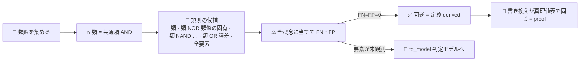
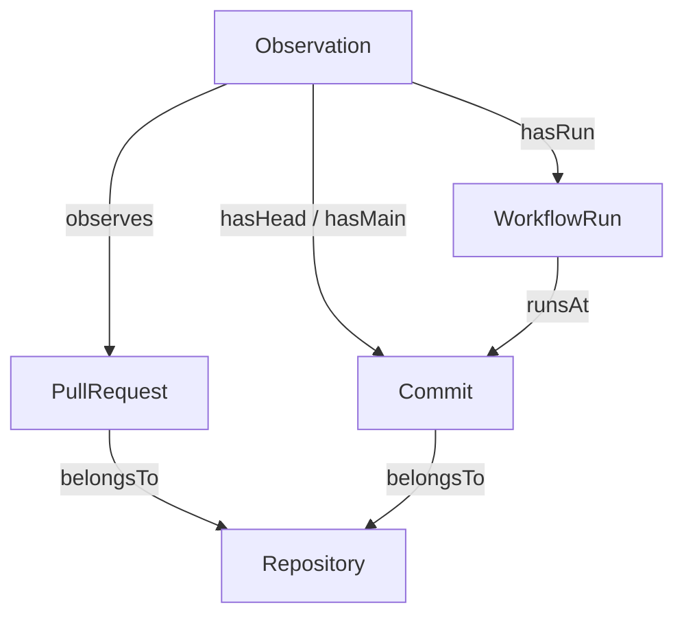

# OnTautoLogy

オントロジーをトートロジーの水準まで持っていく、小さなナレッジグラフです。主張は 🤔 候補 → 🧮 規則で導出 → 👀 観測 → ✅ 証明 の段を上り、最上段は「見ていない場合も含めて常に成り立つ」＝トートロジーです。Python 3.11 以降の標準ライブラリだけで動き、取得・書き込み・マージ・CI 起動・LLM 呼び出しは行いません。

## 🧭 2つの用途

| | 問い | 置き場 | 例データ |
| --- | --- | --- | --- |
| 🧩 第二弾 | 〇〇は何の要素があれば〇〇として成立するか。「〇〇は🔳🔳の類似」を集め、共通項と見分けから定義を作る | `ontautology.py`（define・roundtrip）＋ `tools/tautology.py`（rules・judge・equivalent） | `examples/concepts-20261115.json` |
| 🔭 第一弾 | 多数のリポジトリの PR を、観測の履歴ごと1つのグラフで見る（親の監査ダッシュボード向け） | `gh_audit/gh_audit.py` | `examples/audit-20261114.json`・`examples/flutter-absorption.json` |

どちらも同じ芯（辿る・循環・順序・根拠の段・鍵の昇格）の上に乗っています。Aoi の命題（逆・裏・対偶と判例）や TalkCompress の往復・判定モデルの延長線です。

## 📂 構成

```
ontautology.py          🧠🧩 本体（汎用だけ・標準ライブラリのみ。これ1本を vendor すれば動く）
tools/
  tautology.py          ⚖️ 規則での判定・可逆な定義・真理値表（第二弾の判定）、証明の段までの距離
  ontology.py           📚 語彙の違反を全部挙げる・鍵に昇格できる属性の組
  knowledgegraph.py     🕸️ 親の fleet コードと同じ名前・形の答え
gh_audit/
  gh_audit.py           🔭 GitHub 監査（PR 監査・plan・diff・Turtle・Flutter 移管台帳）。監査の enhancement はこのフォルダへ
vendor/                 📦 親から借りるもの（vendor.lock.json で SHA 固定）: py_launch.cjs・fleet_check.py
examples/               🌱 第二弾の類似コーパス、第一弾の監査スナップショット・移管台帳
tests/                  🧪 unittest（Redis の答え合わせは任意）
```

依存は 🔭 gh_audit → 🧰 tools → 🧠 本体 の一方向です。本体は tools/・vendor/・gh_audit/ を読まず、tools も gh_audit を読みません（テストで固定）。

## 🚀 すぐ試す

```sh
# 🧩 第二弾
python -S tools/tautology.py rules examples/concepts-20261115.json             # ⚖️ seeds の〇〇ごとに規則を判定し、可逆な定義を出す
python -S tools/tautology.py judge examples/concepts-20261115.json ギター '["AND", "弦楽器", "撥弦", "フレット"]'   # 🧮 1本の規則の FN・FP
python -S tools/tautology.py equivalent '["NOR", "a", "b"]' '["AND", ["NOT", "a"], ["NOT", "b"]]'          # ✅ 書き換えが全通りで同じか
python -S ontautology.py define examples/concepts-20261115.json ギター ピカチュウ 鮭 iPhone エナジードリンク ルイージ   # 🧩 類と種差
python -S ontautology.py roundtrip examples/concepts-20261115.json カフェイン含有 飲料                     # 🔁 要素 → 語の往復

# 🔭 第一弾
python -S gh_audit/gh_audit.py audit examples/audit-20261114.json -o graph.json   # スナップショット → グラフ（複数渡すと履歴）
python -S gh_audit/gh_audit.py plan  graph.json                                  # main 未導入の PR の依存順
python -S gh_audit/gh_audit.py transfers examples/flutter-absorption.json        # Flutter の未吸収機能

python -S -m unittest discover -s tests
```

Node からは親の起動役を通します（ツールごとの `.mjs` / `.cjs` は置きません）。

```sh
node vendor/py_launch.cjs -- ontautology.py define examples/concepts-20261115.json ギター
node vendor/py_launch.cjs -- tools/tautology.py rules examples/concepts-20261115.json
node vendor/py_launch.cjs -- gh_audit/gh_audit.py audit examples/audit-20261114.json -o graph.json
node vendor/py_launch.cjs --call equivalent -- tools/tautology.py '["NOR","a","b"]' '["AND",["NOT","a"],["NOT","b"]]'   # 関数を名前で
```

`uv tool install .`（または `uv tool install git+https://github.com/myon-bioinformatics/OnTautoLogy.git`）で入るのは本体の `ontautology` コマンドです。tools と gh_audit はチェックアウトから使います。

## 🧩 第二弾: 類似から定義を作る

### 📥 集めるもの

```json
{
  "schema": "ontautology-concepts/1",
  "seeds": ["ギター", "ピカチュウ", "鮭", "iPhone", "エナジードリンク", "ルイージ"],
  "similar": [{"left": "ギター", "right": "ベース", "basis": "observed"}],
  "concepts": {
    "ギター": ["楽器", "弦楽器", "撥弦", "フレット", "ボディ", "6弦標準", "中高音主体"],
    "ベース": ["楽器", "弦楽器", "撥弦", "フレット", "ボディ", "4弦標準", "低音主体"]
  }
}
```

- 🌱 `seeds`: 定義したい〇〇。増やすときは `seeds` と `similar`・`concepts` に足すだけです。
- 🔗 `similar`: 「〇〇は🔳🔳の類似」。1つの〇〇に何本でも足せます。`[left, right]` の短い形も可。
- 🧺 `concepts`: 観察した要素。まだ見ていない概念は `null`（判定モデルへ回る）。

### 🔄 流れ



TalkCompress の判定モデルと同じ分け方で、まず規則が決め、規則で決められないものだけを判定モデル（LLM）に回します。OTL 自身は LLM を呼びません。

### 📊 例データでの結果

`examples/concepts-20261115.json`（12 概念、類似 6 組、seeds 6）で `rules` を実行した結果です。

| 〇〇 | 類似 | 類（共通項） | 定義 = 類 ∧ NOR(類似にしかない要素) | 「類だけ」の精度（FP） |
| --- | --- | --- | --- | --- |
| 🎸 ギター | ベース | 楽器・弦楽器・撥弦・フレット・ボディ | NOR(4弦標準, 低音主体) | 0.92（ベース） |
| ⚡ ピカチュウ | ライチュウ | ポケモン・でんきタイプ・ねずみ分類 | NOR(ほっぺ蓄電, 進化後(かみなりのいし)) | 0.92（ライチュウ） |
| 🐟 鮭 | サクラマス | 魚類・サケ科・サケ属・遡河回遊魚・食用 | NOR(桜色の婚姻色, 降海型ヤマメ(O.masou)) | 0.92（サクラマス） |
| 📱 iPhone | Android | スマートフォン・タッチパネル・アプリ実行環境・モバイル通信 | NOR(Google系OS, 複数メーカー採用) | 0.92（Android） |
| 🥤 エナジードリンク | コーヒー | 飲料・カフェイン含有・覚醒目的 | NOR(焙煎豆, 抽出液, 苦味) | 0.92（コーヒー） |
| 🟢 ルイージ | マリオ | 任天堂・ゲームキャラクター・人間・配管工・帽子・オーバーオール | NOR(兄, 赤色) | 0.92（マリオ） |

「類だけ」の規則は毎回その類似を通してしまい（FP）、類似にしかない要素を NOR で除くと可逆になります。同点の候補が並んだときは、全要素を並べただけの規則より、類から組んだ規則を先にします。

### ⚖️ 判定の読み方

| 判定 | 意味 | 何が覆すか |
| --- | --- | --- |
| 命題（規則 → 〇〇）・対偶 | 規則が通すなら〇〇 | FP（他の概念を通した） |
| 逆（〇〇 → 規則）・裏 | 〇〇なら規則が通す | FN（〇〇を落とした） |
| `reversible` | FN も FP も 0、未観測もなし | 根拠の段は `derived` |
| `to_model` | 要素が未観測で規則では決められない | 判定モデルへ回す |
| `equivalent` | 2本の規則が真理値表の全通りで同じ | 根拠の段は `proof` |

規則は JSON の木で、`["AND", "弦楽器", ["NOR", "4弦標準", "低音主体"]]` のように AND・OR・NOT・NAND・NOR を入れ子にします。空の AND は常に真、空の OR は常に偽です。

### 🔁 往復と類・種差

- `define` は類似群の共通項（類）と、他の全概念から見分ける最小の要素の組（種差）を出します。
- `roundtrip` は要素の集合から元の語へ戻せるかを見ます。`カフェイン含有 飲料` はエナジードリンクとコーヒーの両方に当たり `collides`、`炭酸` を足すとエナジードリンクだけに戻ります（`unique`）。
- 反例（`6弦ベース` など）が来ると `collides` になり、最小識別鍵が組み替わります。類似先が未観測（`null`）や `basis=hypothesis` だけなら `derived` に上がりません。

### ⚠️ 限界と次

- `reversible` は集めた概念の範囲での話です。概念が1つ増えると FP が出ることがあります（テストで固定）。
- 類似が1つずつだと、種差は「その1つとの違い」になります。ギター↔ウクレレ↔三味線のように類似を増やすほど、類は全員の本質に絞られ、種差が意味を持ちます。
- 種差が名前の言い換え（`白鮭(O.keta)`、`Apple製` など）になると定義が堂々巡りになります。これを見つける検査はまだありません。

## 🔭 第一弾: GitHub 監査

入力は継続監査サイトの「統合証跡JSON」（`integration-audit/3`）です。観測 JSON の `{"aoi_integration": {...}}` で包まれた形も受け付けます。GitHub への取得・書き込みは行いません。

### 🗂️ オントロジー

クラスと関係は `gh_audit/gh_audit.py` の `RELATIONS`（関係ごとの domain と range）だけで定義し、クラスの一覧はそこから導きます（`tools/ontology.classes`）。JSON と Turtle へ同じ定義を出し、読込後に `tools/ontology.violations` と監査固有の規則で検証します。

| クラス | 識別子の範囲 | 主な関係 |
| --- | --- | --- |
| Repository | owner/name | 他の実体から belongsTo |
| PullRequest | リポジトリ＋PR番号 | dependsOn、overlapsWith |
| Observation | 入力スナップショットの digest＋PR | observes、hasHead、hasBase、hasMain |
| Commit | リポジトリ＋完全 SHA | belongsTo |
| Branch | リポジトリ＋ブランチ名 | Observation から targetsBranch |
| File | リポジトリ＋相対パス | Observation から changesFile |
| WorkflowRun | リポジトリ＋run ID＋attempt | runsAt、Observation から hasRun |

ほかに Issue、Review、Job、FixedSHA、Artifact、Evidence、EvidenceGap、MainGap、Task、CompletionRecord、Snapshot があります。



- 観測に取得日時・出典・作業状態・merged・mergeable・main 包含を残します。未取得は `null` のままで、false にしません。変更ファイルの未取得は `files_observed=false` で区別します。
- run は自分のコミット（`runsAt`）にだけ結び付けます。PR の head と同じだとは仮定せず、head が未取得の run にはコミットを作りません。attempt ごとに別のノードです。
- 同じリポジトリで変更パスが重なったときだけ `overlapsWith` を導出します（basis は derived）。Git の競合を意味しません。
- 依存は監査側の主張として取り込み、出典と観測 ID を関係に付けます。Turtle では `rdf:Statement` で表し、古い依存を今も有効な事実に昇格させません。
- `edges_of(graph)` が監査グラフを芯の辺に直します。`dependsOn` と `changesFile` は向きを返し、向きのない `overlapsWith` は両向きにします。循環と順序は `cycles GRAPH dependsOn`、`order GRAPH dependsOn` のように依存の辺だけで問います。

### 🪜 統合順序（`plan`）

PR ごとに最新の観測を選び、`contained_in_main=true` の依存先を消化済みとして、芯の `order` で順序を出します。merged だけでは main への導入を推定しません。未観測の依存先、循環、その下流は `blocked` に残し、独立した部分の順序は出します。同時刻に矛盾するスナップショットがあればエラーにします。順序は依存関係の制約だけで、CI・未解決レビュー・競合・保留の受入条件は監査ビューで確認します。

### 📋 open PR の棚卸し（任意）

`open_pr_inventory` は任意のトップレベル配列です。無い入力は従来どおりに計画します。空配列は「どのリポジトリも範囲に含めない」という宣言で、「どこも PR がゼロ」ではありません。各要素は owner/name 1つに対応します。

```json
{"repository":"myon-bioinformatics/Ironmate","checked_at":"2026-11-15T12:00:00Z",
 "complete":true,"open_pr_numbers":[]}
```

- ✅ 完全な要素は、重複のない正の PR 番号（Draft を含む）を並べます。`[]` は、その確認時点でそのリポジトリに open PR が無いことを明示します。取得失敗や部分取得は `"complete":false,"open_pr_numbers":null` で、空配列にはしません。
- 📸 入力ごとに `Snapshot` ノードを作ります（records が無くても）。digest・観測時刻・明示の棚卸しを残し、`derived_from` で PR の観測とつなぎます。Turtle では構造化メタデータを JSON テキストの文字列リテラルにします。
- 🪜 `plan` はリポジトリごとに最新の `checked_at` を使います（不完全でも）。範囲が不完全なら古い PR を予定に入れず `inventory_uncertainty` を返します。完全な範囲がメンバーを決めますが、並んだ PR には同じスナップショットの行が必要で、無ければ `missing_rows` と `blocked` に出ます。古い証跡を今の証跡に昇格しません。同時刻の矛盾は ambiguous として拒否します。
- 🚫 消えたことは完了ではありません。依存先が見えなくなっても、観測で `contained_in_main: true` が確かめられない限り下流をブロックします。履歴のノードと証跡は消しません。不完全な棚卸しでは `plan` の終了コードは 2 です。これは依存の計画であって、マージの許可や CI の判定ではありません。

### 📦 Flutter の未吸収機能

`examples/flutter-absorption.json` に、固定 SHA の元ファイル、移管先候補、受入条件、検証 SHA・Actions 証跡を記録します。初期登録は主要機能 12 群と追加要望 2 件で、全パターンの棚卸し完了や吸収完了は意味しません。アーカイブ後も元 SHA への紐付けを保ち、Flutter の active 監視とは分けます。

- `transfers` は未完了または棚卸し範囲が未確定なら終了コード 2、入力不整合なら 1 です。
- `state=完了` には、元 SHA と移管先 SHA に一致する receipt、移管先ファイル、main 反映の記録、全受入条件の ID、移管先の Actions URL が必要です。これは記録の整合性検査で、CI 結果・main 包含・機能同等性の独立検証ではありません。移管先が未決でも `target.repository=null` で残せます。
- 機能は Task として `migration_source`（元 File）・`migration_target`（移管先 Repository）に結び、5 状態と Snapshot・Evidence を保ちます。追加要望は `kind=request` で既存機能の未吸収と区別します。

### 📊 例データでの結果

`examples/audit-20261114.json`（8 リポジトリ、観測した PR は 14 件。依存先として名前だけ出る 1 件を含めて PR ノードは 15）の結果です。2026年11月14日 23:12 JST の監査から抜き出した履歴で、現在の GitHub の状態ではありません。

| 問い | 結果 |
| --- | --- |
| `audit` | 719 ノード、1,671 辺（File 542、WorkflowRun 93、Commit 32、PullRequest 15、Observation 14） |
| `check` | 所見なし |
| `plan` | 順序 5 件、ブロック 1 件（`SakAnalytics#45` が未観測の `SakAnalytics#44` を待つ）。終了コード 2 |
| `cycles GRAPH dependsOn` | なし |
| `reach GRAPH file:myon-bioinformatics/Aoi:README.md` | 96 ノード、うち PR 12 件 |
| `ladder` | 観測 1,646、導出 50（変更パスの重なり）、候補 0、証明 0 |

監査の入力には「常に成り立つ」と言える関係がないので、証明の段は 0 本です。第二弾の `equivalent` のように、他で証明された関係を辺として渡したときに埋まります。

## 🧠 共通の芯

### 🪜 根拠の段

| basis | 意味 |
| --- | --- |
| `hypothesis` | 誰も確かめていない候補。`reach` は候補として示すだけで、その先へ進まない |
| `derived` | 記録に対する決まった規則（同じ変更パス、名前の一致、集めた概念での可逆な定義など） |
| `observed` | 記録から読んだ。見ていないものについては何も言わない（省略時の既定） |
| `proof` | 見ていない場合も含めて常に成り立つ。ここがトートロジーの段 |

`why` は辿った道で一番弱い段（`weakest`）を返すので、途中に候補が1つあれば証明済みとは読めません。

### 🔗 芯の辺

`{"kind", "source", "target"}` に、呼び出し側が持つもの（`basis`、主張している記録 `lock`、記録自身の時刻 `observed_at` など）を足した dict です。向きは **source = 依存される側 → target = source が変わったら見直す側**。前向きに辿れば影響先、後ろ向きに辿れば根拠です。

| 関数 | 答えること |
| --- | --- |
| `check(edges, nodes=None)` | 形の崩れ、未知の basis、存在しない参照、同じ記録・同じ時刻の主張で中身が違うもの。直さず報告する |
| `reach(edges, start)` | 変更が届く先。深さ・経路・その辺。DAG を仮定しない |
| `why(edges, node)` | 判断が拠っているもの。`cut` は深さ制限で読み残したこと |
| `cycles(edges)` | 循環の代表例。報告するだけで止めない |
| `order(edges, nodes=())` | 「先に必要」の辺から、並行できる組を順に返す（graphlib）。循環とその下流は `blocked`、残りは順序を出す |
| `ladder(edges)` | 段ごと・種類ごとの本数 |
| `key_report(items, candidates)` | 属性の組が鍵になるか: `key` / `repeat` / `collides` / `incomplete` |

同一性は最後に決まります。意味を持たない取っ手を振り、観測を足し、区別できないものをまとめ、新しい観測で割れることを許し、欠けがなく一意な属性の組だけを鍵に昇格させ、衝突は上書きせず報告します。`key_report` はその最後の2段で、第二弾の種差も同じ考え方です。

### ⌨️ コマンド

| コマンド | どこから | 入力 | 答え |
| --- | --- | --- | --- |
| ⚖️ `rules CORPUS [CONCEPT...]` | 🧰 | 類似コーパス | 〇〇ごとの規則の候補と判定、可逆な定義（既定は `seeds`） |
| 🧮 `judge CORPUS CONCEPT RULE` | 🧰 | 類似コーパス | 1本の規則の FN・FP・精度・命題／逆／裏／対偶 |
| ✅ `equivalent RULE RULE` | 🧰 | 規則2本 | 全通りで同じか（`proof`）、違う場合の反例 |
| 🧩 `define CORPUS [CONCEPT...]` | 🧠 | 類似コーパス | 類・種差・往復判定 |
| 🔁 `roundtrip CORPUS ELEM...` | 🧠 | 類似コーパス | 要素をすべて満たす概念（一意・衝突・空） |
| 🔭 `audit FILE...` | 🔭 | 監査スナップショット | グラフ（`--format turtle` で RDF） |
| 🪜 `plan GRAPH` | 🔭 | 監査グラフ | main 未導入の PR の依存順・ブロック・未観測の依存先 |
| 🆚 `diff BEFORE AFTER` | 🔭 | 監査グラフ2つ | 追加・削除・変化した PR |
| 🐢 `turtle GRAPH` | 🔭 | 監査グラフ | RDF/Turtle |
| 📦 `transfers LEDGER` | 🔭 | 移管台帳 | 未吸収・移管先・受入の整合性 |
| 🧪 `check` 💥 `reach` 🔎 `why` 🔁 `cycles` 🪜 `order` `ladder` | 🧠 | どれでも | 所見・影響先・根拠・循環・順序・段ごとの本数 |
| 🔑 `keys GRAPH FIELDS...` | 🧠 | `"items"` を持つ JSON | 属性の組（`id+run` など）が鍵になるか |

🧠 は `ontautology.py`、🧰 は `tools/tautology.py`、🔭 は `gh_audit/gh_audit.py` です。🧰 と 🔭 は本体の口 `main(commands=..., load=...)` に自分のコマンドを足すので、🧠 のコマンドもそのまま使え、CLI・標準入力の決まり・終了コードは1つです。「どれでも」は類似コーパス・素の `{"edges": [...], "nodes": [...]}`・（🔭 経由なら）監査グラフです。全コマンドに `-o FILE` があり、ファイル名を `-` にすると標準入力の UTF-8 JSON を読みます（1コマンドにつき1回）。

終了コード: `0` 答えた / `1` 入力エラー / `2` 答えたが要確認（所見・循環・ブロック・未知のノード・鍵にならない・差分あり・定義の衝突や未観測・可逆でない・同値でない）。`2` は道具の失敗ではなく、入力についての答えです。

### 🐍 Python・Node から呼ぶ

```python
import ontautology as ot
from tools import tautology
from gh_audit import gh_audit

tautology.rules(corpus, "ギター")["definition"]       # 可逆な最初の規則
ot.define_concepts(corpus, ["ギター"])                 # 類と種差
gh_audit.plan(gh_audit.audit([snapshot]))             # 監査グラフ → 依存順
```

Node からは `vendor/py_launch.cjs` の `--call 関数名` で、`if __name__ == "__main__"` を通さずに関数を名前で呼べます（引数は1つずつ JSON）。大きな JSON は引数ではなく CLI のファイル入力か標準入力で渡します。GraphQL は取得側で `integration-audit/3` へ変換する境界で、本体から認証・HTTP を呼びません。Rust への切り出しは同じ JSON と終了コードを保つ案で、未実装・未測定です。

## 🧰 tools

本体の芯を組み合わせて、名前の意味（オントロジー → トートロジー）に沿った問いに答えます。実装を二重に持たず、芯を呼ぶだけです。

| ファイル | 関数 | 答えること |
| --- | --- | --- |
| ⚖️ `tautology.py` | `holds` `judge` `rules` `equivalent` | 規則での判定・可逆な定義・真理値表（第二弾） |
| ✅ `tautology.py` | `standing` `gaps` `entailed` | ノードが立つ段（深さ無制限で一番弱い段）、証明未満の辺、推移的な種類で証明から従うがまだ書かれていない辺 |
| 📚 `ontology.py` | `classes` `violations` `identity` | 渡した語彙（`gh_audit.RELATIONS` と同じ形）から外れた所を全部挙げる（直さない）。鍵に昇格できる最初の属性の組 |
| 🕸️ `knowledgegraph.py` | `relation_cycles` `topological_order` | 親の `fleet_records` / `vendor_fleet_plan` と同じ名前・形。親は自前の写しの代わりにこれを呼べる |

## 🧪 テスト

```sh
python -S -m unittest discover -s tests                     # 標準ライブラリだけ（Node 26+ があれば Node 経由も）
uv run --no-project --with redis python -m unittest discover -s tests -p test_tools.py -k RedisCrossCheck -v   # 🧱 Redis で答え合わせ
```

| ファイル | 対象 |
| --- | --- |
| `test_ontautology.py` | 芯（辿る・循環・順序・所見・鍵・CLI） |
| `test_concepts.py` | 第二弾の類・種差・往復 |
| `test_tools.py` | tools（判定・可逆・真理値表・語彙・依存の向き）と Redis の答え合わせ |
| `test_gh_audit.py` | 第一弾の監査 |
| `test_fleet.py` | vendor のロック・Action の SHA 固定・Node 経由と Python の一致 |

🧱 `RedisCrossCheck` は、外部モジュールで先に考え方を確かめるための足場です。Redis の集合で同じ問い（`reach` の到達先、`key_report` の判定、規則が通す概念を `SINTER`・`SUNION`・`SDIFF` で、類と種差を `SINTER`・`SDIFF` で）を別に解き、乱数で作った入力すべてで本体と一致するかを見ます。`redis` パッケージか `redis-server` が無ければ skip し、CI の `redis` ジョブでだけ skip を失敗にします。サーバーは一時ディレクトリの unix socket で立て、ポートも保存も使いません。本体と tools は Redis を import しません。

## 🧭 置くもの・置かないもの

- 置く: 横断して見るためのグラフのロジック、類似から定義を作る判定、その用途としての GitHub 監査の読み取り。
- 置かない: GitHub や Git からの取得、各リポジトリ固有の記録形式の解釈、LLM の呼び出し、画面。それらは記録を書くリポジトリ・親（myon-bioinformatics）・TalkCompress の役目で、ここを呼ぶ側です。画面が要るときも HTML・CSS・JS は Python 側（`web_ui.py` など）で組みます。
- OWL 準拠は主張しません。SPARQL や GraphQL の代わりに、関数を名前で呼びます。

## 📝 方針メモ（たたき台）

リポジトリのあり方をルールとしてグラフに載せる案は、[docs/policy-rules.md](docs/policy-rules.md) にあります。実装ではなく、見直し前提の設計メモです。
